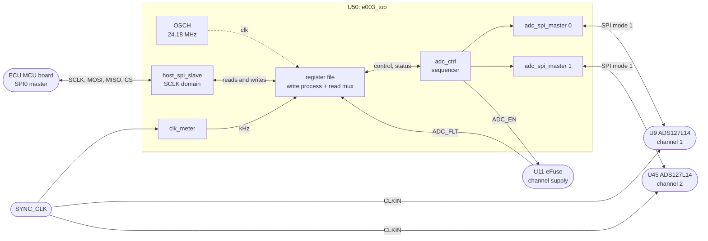
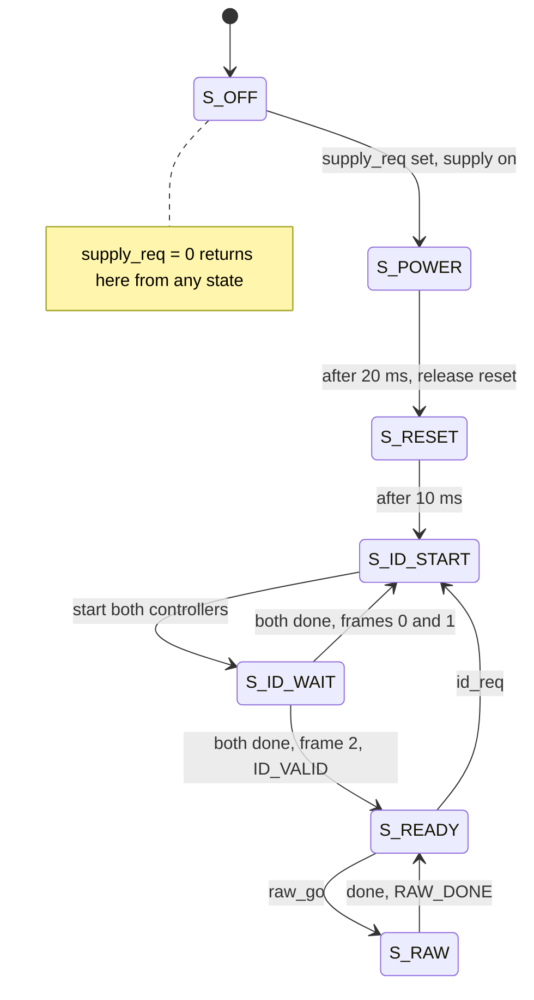

# The e003 bring-up gateware, explained

*For an engineer who writes Rust and embedded Rust, and has never used an FPGA or read VHDL.*

This document explains, line by line where it matters, what the gateware in
`gateware/` does and why it is written the way it is. It assumes you know
SPI, registers, interrupts and state machines from microcontroller work, and
nothing about hardware description languages.

- **Part 1** is a ten-minute model of an FPGA, built from things you already know.
- **Part 2** is VHDL for Rust programmers: just enough syntax and semantics to read this code.
- **Part 3** walks through every source file, bottom-up, with the code inline.
- **Part 4** covers the constraint files that tie the design to the chip and the board.
- **Part 5** covers the simulation testbench.
- **Part 6** shows how a Rust host talks to the board.
- **Part 7** lists what this gateware does not do yet.
- The **glossary** and **further reading** are at the end.

Every code block is copied verbatim from the repository, and its heading links
to the exact lines on GitHub. The links are pinned to commit
[`d276b37`](https://github.com/tnagyzambo/adc-board/tree/d276b37a7feb5533120df5d34202f5b6d1ef1e00/gateware),
so they keep pointing at the right lines as the code moves on. The document
quotes 1,137 of the 1,589 lines (72 %) of VHDL in the repository; the appendix breaks that down
by file.

> **Status at that commit.** The design builds in Lattice Diamond with no
> timing errors and passes its simulation testbench; the most recent change
> (the frame counter in `host_spi_slave`, section 3.5) has yet to be rebuilt.
> Nothing has run on a board yet. `gateware/README.md` has the build and
> bring-up procedure.

## Contents

- [Part 1: FPGAs for a firmware engineer](#part-1-fpgas-for-a-firmware-engineer)
- [Part 2: VHDL for Rust programmers](#part-2-vhdl-for-rust-programmers)
- [Part 3: The design, file by file](#part-3-the-design-file-by-file)
  - [3.1 What it does](#31-what-it-does) ·
    [3.2 e003_pkg](#32-e003_pkg-shared-constants-and-functions) ·
    [3.3 clk_meter](#33-clk_meter-measuring-sync_clk) ·
    [3.4 adc_spi_master](#34-adc_spi_master-talking-to-one-converter) ·
    [3.5 host_spi_slave](#35-host_spi_slave-the-boards-spi-peripheral) ·
    [3.6 adc_ctrl](#36-adc_ctrl-power-reset-and-the-id-read) ·
    [3.7 e003_top](#37-e003_top-wiring-it-together) ·
    [3.8 What it became in silicon](#38-what-it-became-in-silicon)
- [Part 4: Constraints](#part-4-constraints)
- [Part 5: Simulation](#part-5-simulation)
- [Part 6: Talking to the board from Rust](#part-6-talking-to-the-board-from-rust)
- [Part 7: What it does not do yet](#part-7-what-it-does-not-do-yet)
- [Glossary](#glossary) · [Further reading](#further-reading) · [Appendix: coverage](#appendix-coverage)

---

## Part 1: FPGAs for a firmware engineer

### 1.1 Not a processor

A microcontroller fetches instructions from flash and executes them one after
another. An FPGA has no instructions. It is a grid of small, configurable
logic elements and a programmable network of wires between them. The
*bitstream* that you load sets what every element does and how they are
connected; from then on the chip **is** that circuit. Every part of it runs
at the same time, all the time.

The board's FPGA, U50, is a Lattice **LCMXO2-4000HC** (MachXO2 family). Its
building blocks, with the counts that matter here:

| Resource | Count | What it is | Nearest firmware idea |
|---|---:|---|---|
| LUT4 | 4320 | A 16-entry truth table: any Boolean function of 4 inputs | A `const TABLE: [bool; 16]` indexed by four input bits |
| Flip-flop (register) | 4320 + 204 in I/O | Stores one bit; copies its input to its output on a clock edge | One bit of a `static mut`, updated only on a timer tick |
| Carry chain | in every slice | Fast adder hardware for counters | — |
| Block RAM | 10 × 9 kbit | Dual-port memory | SRAM (unused by this design) |
| I/O cell | 68 usable pins | Selectable voltage, pull-up/down, tri-state | A GPIO with its mode registers |
| OSCH | 1 | Internal oscillator, 2.08 to 133 MHz | The MCU's internal RC oscillator |
| EFB | 1 | Hardened SPI, I²C, timer, flash access | Hardware peripherals (unused here) |
| Configuration flash, user flash | — | Holds the bitstream; 96 kbit for data | Program flash, data flash |

A larger function, such as an 8-bit comparison, becomes several LUTs feeding
each other. A counter becomes a row of flip-flops with an adder in front of
them. Nothing is "executed": a signal propagates through the logic in
nanoseconds.

Further reading: [Field-programmable gate array (Wikipedia)](https://en.wikipedia.org/wiki/Field-programmable_gate_array),
[MachXO2 family page (Lattice)](https://www.latticesemi.com/Products/FPGAandCPLD/MachXO2).

### 1.2 The one model you need: synchronous logic

Almost all FPGA logic, and all of this design, is *synchronous*. State lives
only in flip-flops. Every flip-flop belongs to a **clock**, and changes only
on that clock's rising edge. Between edges, the LUTs compute what every
flip-flop will hold after the next edge, from what the flip-flops hold now
and from the inputs. At the edge, all of them update at once.

So one clock domain behaves like this:

```rust
// What a clock domain does, conceptually. There is no CPU running this:
// next_state is a circuit, and every register updates at the same instant.
loop {
    wait_for_rising_edge(clk);
    state = next_state(&state, &inputs);
}
```

`next_state` is a pure function, implemented as LUTs. It has to settle within
one clock period, from the moment the flip-flops change to the next edge.
Proving that is the job of *static timing analysis* (section 1.4).

If you have written a state machine that runs in a periodic timer interrupt,
`match self.state { ... }` with a fresh decision every tick, you already have
the right instinct. The differences are that the "interrupt" costs nothing,
cannot be late, and every block of logic has its own, all running at once.

### 1.3 More than one clock: the FPGA's data race

This design has four clocks:

| Clock | Frequency | Source | Drives |
|---|---|---|---|
| `clk` | 24.18 MHz | The FPGA's internal oscillator | Almost everything |
| `host_sclk_i` | up to 20 MHz | The host's SPI clock | The host SPI shift logic |
| `sync_clk_i` | 8.192 MHz | The stack's sample clock | A 2-bit divider in the clock meter |
| `host_cs_n_i` | per frame | The host's chip select | A 4-bit frame counter |

Logic in one clock domain may not simply read a flip-flop from another. The
reading flip-flop samples at an edge of *its* clock, which can land just as
the other value changes. A flip-flop that samples a changing input can be
left between 0 and 1 for an unpredictable time: it goes **metastable**. This
is the hardware equivalent of a data race between two cores with no
synchronisation, except that the "torn value" can be neither 0 nor 1.

The standard cures, all used in this design, are:

- **Two-flip-flop synchroniser.** Pass a single bit through two flip-flops in
  the receiving domain. The first may go metastable, but it has a whole clock
  period to settle before the second samples it.
- **Toggle handshake.** To pass a multi-bit value, hold it still in the
  sending domain and flip one bit. The receiver synchronises only that bit,
  and reads the value once it sees the flip; by then the value has been
  stable for several clock periods.
- **Quasi-static data.** A value that is known not to change while it is
  read can be read directly.

Every crossing in this design is pointed out where it happens.
Further reading: [Metastability (Wikipedia)](https://en.wikipedia.org/wiki/Metastability_(electronics)),
[Clock domain crossing (Wikipedia)](https://en.wikipedia.org/wiki/Clock_domain_crossing), and the classic
paper [Clock Domain Crossing Design & Verification Techniques (Cummings)](http://www.sunburst-design.com/papers/CummingsSNUG2008Boston_CDC.pdf).
The paper's examples are in SystemVerilog, but every idea carries over.

### 1.4 From source code to a configured chip

| Step | Tool in this repository | What it does | Embedded Rust equivalent |
|---|---|---|---|
| Simulate | GHDL | Runs the VHDL as an event-driven program in simulated time, against a testbench | `cargo test` on the host, against a mock HAL |
| Synthesise | Lattice Diamond (LSE) | Turns the VHDL into a netlist of LUTs, flip-flops and primitives | `rustc` code generation |
| Map, place and route | Diamond (map, par) | Assigns every element to a physical site and routes the wires | Linking, but onto a 2-D grid of real resources |
| Timing analysis | Diamond (trce) | Proves every path between flip-flops settles within its clock period, at worst-case voltage and temperature | No real equivalent; closest is worst-case execution time analysis, but it is exact and always run |
| Generate the bitstream | Diamond (bitgen) | `.bit` for SRAM, `.jed` for flash | `.elf` / `.bin` |
| Program | openFPGALoader and a J-Link | Loads SRAM, or writes flash, over JTAG | `probe-rs`, `cargo flash` |

At power-up the MachXO2 copies its configuration from its internal flash into
the memory cells that control the fabric, which takes milliseconds. Then it
sets every flip-flop to its initial value and lets the design run. Loading
over JTAG writes the same memory cells directly, and is lost at power-off.

The tool steps are wrapped by `make sim` and `make build`, which run inside a
Docker container; `gateware/README.md` has the details.

---

## Part 2: VHDL for Rust programmers

VHDL is strongly typed, explicit, and verbose. It will feel closer to Rust
than C does: no implicit integer conversions, exhaustive `case`, separate
declaration and implementation. The big difference is what the code
*means*: it describes a circuit, not a sequence of steps.

### 2.1 Vocabulary

| VHDL | Rust analogue | Notes |
|---|---|---|
| `library ieee; use ieee.numeric_std.all;` | `use` | `work` is the current library, like `crate` |
| `package` / `package body` | a `mod` of public items / their bodies | `e003_pkg` |
| `entity` | a public interface: the block's pins, plus const generics | |
| `architecture` | the implementation of an entity | One entity could have several |
| `generic` | a const generic | Fixed at build time |
| `port` with `in` / `out` | input and output fields | Direction is checked |
| `signal` | a wire, or a register if assigned on a clock edge | |
| `variable` | a `let mut` local inside a process | Updates immediately |
| `process` | a closure the simulator re-runs when a signal it watches changes | In hardware, a block of logic |
| `rising_edge(clk)` | "on each tick of `clk`" | Creates registers |
| `std_logic` | `enum { U, X, Zero, One, Z, W, L, H, DontCare }` | Only 0, 1 and Z exist in silicon; the rest are for simulation |
| `std_logic_vector(7 downto 0)` | `[bool; 8]`, index 7 is the MSB | No arithmetic |
| `unsigned(7 downto 0)` | `u8`, with wrapping arithmetic | Any width; `+ 1` on a 4-bit `unsigned` wraps 15 to 0 |
| `natural range 0 to 24` | an integer with declared bounds | The tool picks the width; simulation checks the range, like a debug-build overflow check |
| `type state_t is (S_IDLE, ...)` | a fieldless `enum` | Synthesis picks the encoding |
| `array (0 to 1) of ...` | `[T; 2]` | |
| `x"A5"`, `16#07#` | `0xA5` | A bit string and an integer |
| `a & b` | bit concatenation | `(a << len_b) \| b`, for any widths |
| `(others => '0')` | `[false; N]`, `Default` | Fills every element |
| `case ... when others =>` | `match ... _ =>` | Must be exhaustive, as in Rust |
| `for ... generate` | a macro that stamps out copies of hardware | |
| `entity work.x port map (...)` | constructing an instance and wiring its fields | |
| `component` for a vendor primitive | an `extern "C"` declaration | The body is in the silicon |
| `'length`, `'range`, `'high` | `.len()`, `0..len`, `len - 1` | "Attributes" |
| `assert`, `report` | `assert!`, `println!` | Testbenches |
| `wait for 125 ns` | `sleep` in simulated time | Simulation only |

Comments start with `--`.

### 2.2 Entities and architectures

An **entity** declares a block's interface. Here is the smallest one in the
design, the clock meter:

[`rtl/clk_meter.vhd, lines 13–23`](https://github.com/tnagyzambo/adc-board/blob/d276b37a7feb5533120df5d34202f5b6d1ef1e00/gateware/rtl/clk_meter.vhd#L13-L23)

```vhdl
entity clk_meter is
  generic (
    G_GATE_CYCLES : positive  -- system clocks in 1 ms
  );
  port (
    clk      : in  std_logic;
    rst      : in  std_logic;
    meas_clk : in  std_logic;
    khz      : out unsigned(15 downto 0)  -- 0 when the clock is absent
  );
end entity;
```

`G_GATE_CYCLES` is a generic, fixed when the block is instantiated. The
ports are wires: three inputs and one 16-bit output. The **architecture**
says what happens between them:

[`rtl/clk_meter.vhd, lines 25–42`](https://github.com/tnagyzambo/adc-board/blob/d276b37a7feb5533120df5d34202f5b6d1ef1e00/gateware/rtl/clk_meter.vhd#L25-L42)

```vhdl
architecture rtl of clk_meter is

  signal div   : unsigned(1 downto 0) := (others => '0');
  signal s     : std_logic_vector(2 downto 0) := (others => '0');
  signal gate  : natural range 0 to G_GATE_CYCLES - 1 := 0;
  signal edges : unsigned(14 downto 0) := (others => '0');
  signal khz_q : unsigned(15 downto 0) := (others => '0');

begin

  khz <= khz_q;

  process (meas_clk)
  begin
    if rising_edge(meas_clk) then
      div <= div + 1;
    end if;
  end process;
```

Before `begin` come declarations: five signals, each with an initial value,
which is what the flip-flops hold right after configuration. After `begin`
come *concurrent statements*, which all exist at once. `khz <= khz_q;` is a
wire from an internal signal to the output port. The `process` is a block of
logic; this one is a 2-bit counter clocked by `meas_clk`.

### 2.3 Signals, registers, and the rule that matters most

A signal assigned inside `if rising_edge(clk)` becomes a flip-flop. And a
signal assignment, written `<=`, **does not take effect until the process
finishes**. Every read in the process sees the value from before the clock
edge; if a signal is assigned twice, the last assignment wins. A
**variable**, written `:=`, updates immediately, like an ordinary local.

Here is the clock meter's main process:

[`rtl/clk_meter.vhd, lines 44–70`](https://github.com/tnagyzambo/adc-board/blob/d276b37a7feb5533120df5d34202f5b6d1ef1e00/gateware/rtl/clk_meter.vhd#L44-L70)

```vhdl
  process (clk)
    variable edge : std_logic;
  begin
    if rising_edge(clk) then
      s    <= s(1 downto 0) & div(1);
      edge := s(2) xor s(1);

      if rst = '1' then
        gate  <= 0;
        edges <= (others => '0');
        khz_q <= (others => '0');
      elsif gate = G_GATE_CYCLES - 1 then
        gate  <= 0;
        khz_q <= shift_left(resize(edges, 16), 1);
        if edge = '1' then
          edges <= to_unsigned(1, edges'length);
        else
          edges <= (others => '0');
        end if;
      else
        gate <= gate + 1;
        if edge = '1' and edges /= 2**edges'length - 1 then
          edges <= edges + 1;
        end if;
      end if;
    end if;
  end process;
```

Line [`clk_meter.vhd:48`](https://github.com/tnagyzambo/adc-board/blob/d276b37a7feb5533120df5d34202f5b6d1ef1e00/gateware/rtl/clk_meter.vhd#L48) assigns `s`, and the very next line reads
`s` to compute `edge`. Because `s` is a signal, that read sees the *old*
`s`. So `edge` compares the two oldest stages of the shift register, which is
what the edge detector needs. The same process in Rust, with the semantics
made explicit:

```rust
#[derive(Clone)]
struct ClkMeter { s: u8, gate: u32, edges: u16, khz_q: u16 }

impl ClkMeter {
    /// Runs once per rising edge of `clk`. `self` holds every register
    /// before the edge; the return value holds every register after it.
    fn tick(&self, rst: bool, div_bit1: bool, gate_cycles: u32) -> Self {
        let mut next = self.clone();                                 // signals: written to `next`
        next.s = ((self.s << 1) | div_bit1 as u8) & 0b111;
        let edge = ((self.s >> 2) ^ (self.s >> 1)) & 1 == 1;         // variable: computed now, from old `s`
        if rst {
            next.gate = 0; next.edges = 0; next.khz_q = 0;
        } else if self.gate == gate_cycles - 1 {
            next.gate = 0;
            next.khz_q = self.edges << 1;
            next.edges = edge as u16;
        } else {
            next.gate = self.gate + 1;
            if edge && self.edges != 0x7FFF { next.edges = self.edges + 1; }
        }
        next
    }
}
```

When you read a clocked process, read it as `fn tick(&self) -> Self`.

### 2.4 Combinational logic

Logic with no clock is *combinational*: its output is a pure function of its
inputs, recomputed the moment any input changes. It is written either as a
concurrent assignment:

[`rtl/adc_spi_master.vhd, line 59`](https://github.com/tnagyzambo/adc-board/blob/d276b37a7feb5533120df5d34202f5b6d1ef1e00/gateware/rtl/adc_spi_master.vhd#L59)

```vhdl
  busy <= '0' when state = S_IDLE else '1';
```

which is `fn busy(&self) -> bool { self.state != State::Idle }`, or as a
process without `rising_edge` whose sensitivity list names every input. The
register file's read multiplexer in section 3.7 is the large example. One
rule matters there: a combinational process must assign its outputs on every
path. If some path leaves an output unassigned, the output has to *remember*
its old value, and synthesis builds an unwanted latch. That is why the read
multiplexer assigns a default before its `case`.

### 2.5 Types and conversions

VHDL converts nothing implicitly, so conversions are spelled out, as with
`as` and `From` in Rust:

| Expression | Means |
|---|---|
| `unsigned(b)` | Reinterpret bits as a number (`std_logic_vector` to `unsigned`) |
| `std_logic_vector(u)` | And back |
| `to_integer(u)` | `unsigned` to an integer |
| `to_unsigned(n, 8)` | An integer to an 8-bit `unsigned` |
| `resize(u, 16)` | Widen or truncate |
| `shift_left(u, n)` | `u << n`, keeping the width |
| `v(6 downto 0)` | A slice of bits 6 to 0 |

The package's small helpers show several at once:

[`rtl/e003_pkg.vhd, lines 87–95`](https://github.com/tnagyzambo/adc-board/blob/d276b37a7feb5533120df5d34202f5b6d1ef1e00/gateware/rtl/e003_pkg.vhd#L87-L95)

```vhdl
  function to_byte(n : natural) return byte_t is
  begin
    return std_logic_vector(to_unsigned(n mod 256, 8));
  end function;

  function char_byte(c : character) return byte_t is
  begin
    return to_byte(character'pos(c));
  end function;
```

`character'pos(c)` is `c as u32`; `n mod 256` is `n % 256`.

### 2.6 Loops and functions become hardware

A `for` loop in VHDL does not iterate at run time. Synthesis *unrolls* it
into parallel hardware, so the loop count must be known at build time. A
function is likewise inlined at every call, and when its arguments are
constants, synthesis evaluates it at build time, like a `const fn`. The CRC
function is the example (section 3.2).

### 2.7 Instances and `generate`

A block is used by instantiating it and connecting its ports with
`port map (formal => actual, ...)`. `for ... generate` stamps out copies:

[`rtl/adc_ctrl.vhd, lines 121–138`](https://github.com/tnagyzambo/adc-board/blob/d276b37a7feb5533120df5d34202f5b6d1ef1e00/gateware/rtl/adc_ctrl.vhd#L121-L138)

```vhdl
  gen_spi : for i in 0 to 1 generate
    u_spi : entity work.adc_spi_master
      generic map (G_HALF_CYCLES => G_SPI_HALF_CYCLES)
      port map (
        clk   => clk,
        rst   => rst,
        start => m_start(i),
        nbits => m_nbits,
        tx    => m_tx(i),
        rx    => m_rx(i),
        busy  => m_busy(i),
        done  => m_done(i),
        sclk  => adc_sclk(i),
        sdi   => adc_sdi(i),
        cs_n  => adc_cs_n(i),
        sdo   => adc_sdo(i)
      );
  end generate;
```

This makes two physically separate SPI controllers, one per converter. Think
`let spi: [AdcSpiMaster; 2]`, except that each element is its own silicon,
running in parallel with the other.

### 2.8 Simulation-only VHDL

VHDL is also a programming language for testbenches. `wait for 125 ns`,
`report`, `assert`, files and unbounded loops all work in a simulator and
cannot be built into hardware. The testbench in Part 5 uses all of them, much
as a `#[cfg(test)]` module uses `std` on the host. The code that becomes
hardware sticks to the *synthesisable* subset.

Further reading: [Free Range VHDL](https://github.com/fabriziotappero/Free-Range-VHDL-book) (a free book, the best
single introduction), [VHDLwhiz basic tutorials](https://vhdlwhiz.com/basic-vhdl-tutorials/),
[nandland](https://nandland.com/), and the [GHDL documentation](https://ghdl.github.io/ghdl/).

---

## Part 3: The design, file by file

### 3.1 What it does

This is a bring-up image: enough logic to show that a new board works. After
configuration it:

1. **Answers on SPI0** as a register-file peripheral. The host can read an
   identifier (`E003`), a version, the git hash of the build and the string
   `Hello, world! e003-adc-board gateware`, and can write a scratch register
   to prove that writes arrive.
2. **Measures `SYNC_CLK`** against the internal oscillator, and reports it in
   kHz with an in-range flag.
3. On the host's command, **turns on the channel supply** (the TPS25200 eFuse,
   U11), waits 20 ms, **releases both ADS127L14 converters from reset**, waits
   10 ms, then **reads each converter's ID registers** and keeps the replies.
4. **Passes raw SPI frames** from the host to either converter and returns the
   reply, so the converter's command set can be explored on the bench without
   rebuilding the gateware.
5. **Reports** the eFuse's fault flag and the live levels of the converter
   pins.

It does not configure the converters, start conversions, or close any
channel switch. The converters stay in their reset state, in which their
GPIO pins, and so every switch, are off.



| File | Lines | Role | Section |
|---|---:|---|---|
| [`rtl/e003_pkg.vhd`](https://github.com/tnagyzambo/adc-board/blob/d276b37a7feb5533120df5d34202f5b6d1ef1e00/gateware/rtl/e003_pkg.vhd) | 109 | Constants, including every unverified datasheet fact; CRC-8; the hello string | 3.2 |
| [`rtl/clk_meter.vhd`](https://github.com/tnagyzambo/adc-board/blob/d276b37a7feb5533120df5d34202f5b6d1ef1e00/gateware/rtl/clk_meter.vhd) | 72 | `SYNC_CLK` frequency in kHz | 3.3 |
| [`rtl/adc_spi_master.vhd`](https://github.com/tnagyzambo/adc-board/blob/d276b37a7feb5533120df5d34202f5b6d1ef1e00/gateware/rtl/adc_spi_master.vhd) | 148 | SPI controller for one converter | 3.4 |
| [`rtl/host_spi_slave.vhd`](https://github.com/tnagyzambo/adc-board/blob/d276b37a7feb5533120df5d34202f5b6d1ef1e00/gateware/rtl/host_spi_slave.vhd) | 182 | The board's SPI peripheral on SPI0 | 3.5 |
| [`rtl/adc_ctrl.vhd`](https://github.com/tnagyzambo/adc-board/blob/d276b37a7feb5533120df5d34202f5b6d1ef1e00/gateware/rtl/adc_ctrl.vhd) | 262 | Supply, reset and ID-read sequencer; raw frames | 3.6 |
| [`rtl/e003_top.vhd`](https://github.com/tnagyzambo/adc-board/blob/d276b37a7feb5533120df5d34202f5b6d1ef1e00/gateware/rtl/e003_top.vhd) | 365 | Top level: pins, oscillator, register file, wiring | 3.7 |
| [`sim/*.vhd`](https://github.com/tnagyzambo/adc-board/tree/d276b37a7feb5533120df5d34202f5b6d1ef1e00/gateware/sim) | 451 | Testbench, converter model, primitive stand-ins | Part 5 |

### 3.2 `e003_pkg`: shared constants and functions

The package is the design's `mod constants`. Its declaration:

[`rtl/e003_pkg.vhd, lines 11–68`](https://github.com/tnagyzambo/adc-board/blob/d276b37a7feb5533120df5d34202f5b6d1ef1e00/gateware/rtl/e003_pkg.vhd#L11-L68)

```vhdl
package e003_pkg is

  subtype byte_t is std_logic_vector(7 downto 0);
  type byte_array_t is array (natural range <>) of byte_t;

  -- Reported at registers 0x04 and 0x05.
  constant C_GW_VERSION_MAJOR : natural := 0;
  constant C_GW_VERSION_MINOR : natural := 1;

  -- System clock: the MachXO2 internal oscillator (OSCH). The two constants
  -- must name the same frequency; OSCH accepts only the values listed in
  -- the MachXO2 sysCLOCK guide, of which 24.18 MHz is one. The oscillator is
  -- accurate to about +-5.5 %, which sets the accuracy of every interval the
  -- gateware times, the SYNC_CLK measurement included.
  constant C_OSCH_NOM_FREQ : string  := "24.18";
  constant C_SYS_CLK_HZ    : natural := 24_180_000;

  -- Host SPI: byte 0 of every frame. The board's single chip select also
  -- selects the FPGA's configuration port, which treats byte 0 as a
  -- configuration command (GW-13, OI-9), so neither value may be a MachXO2
  -- sysCONFIG command (FPGA-TN-02155 / FPGA-TN-02163). VERIFY against the
  -- command table before the configuration port is enabled in an image.
  constant C_HOST_CMD_READ  : byte_t := x"A5";
  constant C_HOST_CMD_WRITE : byte_t := x"5A";

  -- ADS127L14 register access over its SPI port (SPI mode 1).
  --
  -- VERIFY: the encoding below is an assumption, not taken from the
  -- datasheet. The ADS127L14's registers run past 0x50, so a command byte
  -- needs a 7-bit address, and the assumption is one read/write bit in
  -- bit 7 followed by the address. The ADS127L11, the single-channel
  -- relative, instead uses 0x40 + address to read and 0x80 + address to
  -- write. The raw-transfer registers (0x17 to 0x1F) and `e003_probe.py scan`
  -- try the alternatives on hardware without rebuilding.
  constant C_ADC_CMD_RREG   : byte_t  := x"80";  -- read:  C_ADC_CMD_RREG or address
  constant C_ADC_CMD_WREG   : byte_t  := x"00";  -- write: C_ADC_CMD_WREG or address
  constant C_ADC_REG_DEV_ID : natural := 16#00#;
  constant C_ADC_REG_REV_ID : natural := 16#01#;
  -- Which byte of the response frame carries the register's contents, 0
  -- being the first byte clocked out on SDO. VERIFY.
  constant C_ADC_RESP_BYTE  : natural := 0;
  -- SPI CRC: CRC-8, x^8 + x^2 + x + 1, seeded with 0xFF, over the two
  -- command bytes, MSB first. VERIFY.
  constant C_ADC_CRC_POLY   : byte_t  := x"07";
  constant C_ADC_CRC_INIT   : byte_t  := x"FF";
  -- Half an SCLK period in system clocks: 12 gives about 1 MHz, a quarter of
  -- the 4 MHz that the design summary plans for, to leave margin at bring-up.
  constant C_ADC_SPI_HALF_CYCLES : positive := 12;

  -- Returned at registers 0x40 to 0x7F, NUL padded.
  constant C_HELLO : string := "Hello, world! e003-adc-board gateware";

  function crc8(data : std_logic_vector) return byte_t;
  function to_byte(n : natural) return byte_t;
  function char_byte(c : character) return byte_t;
  function hello_rom return byte_array_t;

end package;
```

Points to note:

- `byte_t` is a *subtype*, an alias with a fixed width, used throughout as the
  `u8` of the design. `byte_array_t` is an array of bytes whose length is left
  open (`natural range <>`), like a slice type; each use fixes the length.
- **Everything marked `VERIFY` is an assumption** that the ADS127L14
  datasheet has not yet confirmed: the read-command encoding
  (`C_ADC_CMD_RREG`), the ID register addresses, which reply byte carries the
  data (`C_ADC_RESP_BYTE`), and the CRC. Keeping them in one place makes a
  correction a one-line change. The raw-transfer registers exist so they can
  be checked on hardware first.
- `C_OSCH_NOM_FREQ` and `C_SYS_CLK_HZ` describe the same thing twice, once in
  the form the oscillator primitive accepts, once as a number the design can
  do arithmetic with.
- `C_HOST_CMD_READ` and `C_HOST_CMD_WRITE` start every host SPI frame. The
  board's chip select also selects the FPGA's own configuration port, which
  reads the first byte of every frame as a configuration command, so these
  must not be configuration commands (requirement GW-13).

The bodies of the functions:

[`rtl/e003_pkg.vhd, lines 72–85`](https://github.com/tnagyzambo/adc-board/blob/d276b37a7feb5533120df5d34202f5b6d1ef1e00/gateware/rtl/e003_pkg.vhd#L72-L85)

```vhdl
  function crc8(data : std_logic_vector) return byte_t is
    variable d   : std_logic_vector(data'length - 1 downto 0) := data;
    variable crc : byte_t := C_ADC_CRC_INIT;
    variable fb  : std_logic;
  begin
    for i in d'high downto 0 loop
      fb  := crc(7) xor d(i);
      crc := crc(6 downto 0) & '0';
      if fb = '1' then
        crc := crc xor C_ADC_CRC_POLY;
      end if;
    end loop;
    return crc;
  end function;
```

This is a bit-serial CRC-8 (polynomial 0x07, seed 0xFF), most significant bit
first, and line for line the same as:

```rust
fn crc8(data: &[u8]) -> u8 {
    let mut crc = 0xFFu8;
    for byte in data {
        for i in (0..8).rev() {
            let fb = (crc >> 7) ^ ((byte >> i) & 1);
            crc <<= 1;
            if fb == 1 { crc ^= 0x07; }
        }
    }
    crc
}
```

In hardware, the loop unrolls into a network of XOR gates that computes the
whole CRC at once. Here it never even does that: it is only called with
constant arguments (section 3.6), so synthesis evaluates it at build time.

[`rtl/e003_pkg.vhd, lines 97–107`](https://github.com/tnagyzambo/adc-board/blob/d276b37a7feb5533120df5d34202f5b6d1ef1e00/gateware/rtl/e003_pkg.vhd#L97-L107)

```vhdl
  function hello_rom return byte_array_t is
    variable rom : byte_array_t(0 to 63) := (others => x"00");
  begin
    -- The last byte stays NUL so the string is always terminated.
    for i in C_HELLO'range loop
      if i - C_HELLO'low < 63 then
        rom(i - C_HELLO'low) := char_byte(C_HELLO(i));
      end if;
    end loop;
    return rom;
  end function;
```

`hello_rom` turns the hello string into a 64-byte array. VHDL strings are
indexed from 1, hence `i - C_HELLO'low`. It is called once, to initialise a
constant in the top level, so it too runs at build time; the result becomes
a small ROM.

### 3.3 `clk_meter`: measuring `SYNC_CLK`

You have already seen the whole of this block in Part 2. What it does: a
2-bit counter clocked by `SYNC_CLK` ([`clk_meter.vhd:37–42`](https://github.com/tnagyzambo/adc-board/blob/d276b37a7feb5533120df5d34202f5b6d1ef1e00/gateware/rtl/clk_meter.vhd#L37-L42)) toggles
its top bit every two `SYNC_CLK` cycles, making a square wave at a quarter of
the input frequency, about 2 MHz. That is slow enough for the 24.18 MHz
system clock to see every edge. The main process
([`clk_meter.vhd:44–70`](https://github.com/tnagyzambo/adc-board/blob/d276b37a7feb5533120df5d34202f5b6d1ef1e00/gateware/rtl/clk_meter.vhd#L44-L70)) then:

1. **Synchronises** the square wave into the `clk` domain through `s`, a
   3-bit shift register. `s(0)` may go metastable; `s(1)` is the clean,
   synchronised copy; `s(2)` is the copy from one clock earlier.
2. **Detects edges**: `edge` is `s(2) xor s(1)`, true for one clock after
   each edge, rising or falling.
3. **Counts edges for 1 ms**: `gate` counts `G_GATE_CYCLES` system clocks,
   24 180 of them. At the end of each window it publishes `edges × 2` as
   `khz_q`, because each edge stands for two `SYNC_CLK` cycles, and starts
   again. `edges` saturates rather than wrapping.

At 8.192 MHz there are 4096 edges per window, so the result is 8192 kHz,
with a resolution of 2 kHz. The window is timed by the internal oscillator,
which is accurate to about ±5.5 %, so the reading is too. With no clock the
counter stops, there are no edges, and the reading falls to 0 within two
windows.

This crossing, from the `SYNC_CLK` domain into the `clk` domain, is the
two-flip-flop synchroniser of section 1.3.

### 3.4 `adc_spi_master`: talking to one converter

Each ADS127L14 has its own SPI bus to the FPGA, on which the FPGA is the
controller, much like an MCU's SPI peripheral in master mode. This block
sends one frame of up to 24 bits and captures the reply. Its interface:

[`rtl/adc_spi_master.vhd, lines 13–32`](https://github.com/tnagyzambo/adc-board/blob/d276b37a7feb5533120df5d34202f5b6d1ef1e00/gateware/rtl/adc_spi_master.vhd#L13-L32)

```vhdl
entity adc_spi_master is
  generic (
    G_HALF_CYCLES : positive  -- half an SCLK period, in clk cycles; at least 4
  );
  port (
    clk   : in  std_logic;
    rst   : in  std_logic;
    start : in  std_logic;
    nbits : in  unsigned(4 downto 0);  -- 0 or above 24 means 24
    tx    : in  std_logic_vector(23 downto 0);
    rx    : out std_logic_vector(23 downto 0);
    busy  : out std_logic;
    done  : out std_logic;  -- one clk when rx is valid
    -- Pins
    sclk  : out std_logic;
    sdi   : out std_logic;
    cs_n  : out std_logic;
    sdo   : in  std_logic
  );
end entity;
```

To send a frame, the user puts the bits in `tx` (left-aligned: bit 23 goes out
first, whatever the length), sets `nbits`, and pulses `start` for one clock.
`busy` stays high until the frame is over, and `done` pulses for one clock
when `rx` holds the reply. The internal state:

[`rtl/adc_spi_master.vhd, lines 34–59`](https://github.com/tnagyzambo/adc-board/blob/d276b37a7feb5533120df5d34202f5b6d1ef1e00/gateware/rtl/adc_spi_master.vhd#L34-L59)

```vhdl
architecture rtl of adc_spi_master is

  type state_t is (S_IDLE, S_LOW, S_HIGH, S_HOLD, S_GAP);
  signal state : state_t := S_IDLE;

  signal tmr   : natural range 0 to 2 * G_HALF_CYCLES := 0;
  signal len   : natural range 1 to 24 := 24;
  signal left  : natural range 0 to 24 := 0;
  signal tx_sr : std_logic_vector(23 downto 0) := (others => '0');
  signal rx_sr : std_logic_vector(23 downto 0) := (others => '0');
  signal rx_q  : std_logic_vector(23 downto 0) := (others => '0');

  signal sdo_meta : std_logic := '0';
  signal sdo_sync : std_logic := '0';

  signal sclk_q : std_logic := '0';
  signal sdi_q  : std_logic := '0';
  signal cs_q   : std_logic := '1';

begin

  sclk <= sclk_q;
  sdi  <= sdi_q;
  cs_n <= cs_q;
  rx   <= rx_q;
  busy <= '0' when state = S_IDLE else '1';
```

`state_t` is an enum, exactly as you would write it in Rust. `tmr` times each
half SCLK period; `left` counts bits still to send; `tx_sr` and `rx_sr` are
shift registers. `sdo_meta` and `sdo_sync` are a two-flip-flop synchroniser
for the converter's data output, which changes on the converter's timing, not
on `clk`. The pins (`sclk`, `sdi`, `cs_n`) are driven straight from
flip-flops (`*_q`), so they cannot glitch.

The process is one `match` on the state, run every system clock:

[`rtl/adc_spi_master.vhd, lines 61–91`](https://github.com/tnagyzambo/adc-board/blob/d276b37a7feb5533120df5d34202f5b6d1ef1e00/gateware/rtl/adc_spi_master.vhd#L61-L91)

```vhdl
  process (clk)
    variable n : natural range 0 to 31;
  begin
    if rising_edge(clk) then
      sdo_meta <= sdo;
      sdo_sync <= sdo_meta;
      done     <= '0';

      if rst = '1' then
        state  <= S_IDLE;
        tmr    <= 0;
        sclk_q <= '0';
        sdi_q  <= '0';
        cs_q   <= '1';
      else
        case state is

          when S_IDLE =>
            if start = '1' then
              n := to_integer(nbits);
              if n = 0 or n > 24 then
                n := 24;
              end if;
              len   <= n;
              left  <= n;
              tx_sr <= tx;
              rx_sr <= (others => '0');
              cs_q  <= '0';
              tmr   <= G_HALF_CYCLES - 1;
              state <= S_LOW;
            end if;
```

The synchroniser and the one-clock `done` pulse come first, outside the
`case`: `done <= '0'` is a default that the `S_GAP` branch overrides. In
`S_IDLE`, a start latches the frame and pulls chip select low. `n` is a
variable, so its clamped value can be used straight away.

[`rtl/adc_spi_master.vhd, lines 93–120`](https://github.com/tnagyzambo/adc-board/blob/d276b37a7feb5533120df5d34202f5b6d1ef1e00/gateware/rtl/adc_spi_master.vhd#L93-L120)

```vhdl
          when S_LOW =>
            if tmr /= 0 then
              tmr <= tmr - 1;
            else
              -- Rising edge: present the next bit.
              sclk_q <= '1';
              sdi_q  <= tx_sr(23);
              tx_sr  <= tx_sr(22 downto 0) & '0';
              tmr    <= G_HALF_CYCLES - 1;
              state  <= S_HIGH;
            end if;

          when S_HIGH =>
            if tmr /= 0 then
              tmr <= tmr - 1;
            else
              -- Falling edge: the converter latches SDI, and SDO has been
              -- stable since the rising edge.
              sclk_q <= '0';
              rx_sr  <= rx_sr(22 downto 0) & sdo_sync;
              left   <= left - 1;
              tmr    <= G_HALF_CYCLES - 1;
              if left = 1 then
                state <= S_HOLD;
              else
                state <= S_LOW;
              end if;
            end if;
```

`S_LOW` and `S_HIGH` alternate, each lasting `G_HALF_CYCLES` system clocks
(12, so each SCLK half-period is about 496 ns and SCLK runs at about 1 MHz).
The `tmr` countdown is the usual "wait N ticks" idiom you would write in a
timer interrupt. This is **SPI mode 1**: the controller changes SDI on the
rising edge of SCLK, and both sides sample on the falling edge.

```text
state   IDLE |S_LOW |S_HIGH|S_LOW |S_HIGH| ... |S_HIGH|S_HOLD|S_GAP      |IDLE
cs_n    ‾‾‾‾‾\_____________________________ ... ______________/‾‾‾‾‾‾‾‾‾‾‾‾‾‾‾‾
sclk    ____________/‾‾‾‾‾‾\______/‾‾‾‾‾‾\_ ... _/‾‾‾‾‾‾\_____________________
sdi     ------------X bit 23      X bit 22   ...  X bit 0       X 0
                    ^ FPGA changes SDI on the rising edge
                           ^ converter latches SDI, FPGA samples SDO, on the falling edge
```

[`rtl/adc_spi_master.vhd, lines 122–146`](https://github.com/tnagyzambo/adc-board/blob/d276b37a7feb5533120df5d34202f5b6d1ef1e00/gateware/rtl/adc_spi_master.vhd#L122-L146)

```vhdl
          when S_HOLD =>
            -- Half a period from the last falling edge to CS high.
            if tmr /= 0 then
              tmr <= tmr - 1;
            else
              cs_q  <= '1';
              sdi_q <= '0';
              tmr   <= 2 * G_HALF_CYCLES - 1;
              state <= S_GAP;
            end if;

          when S_GAP =>
            -- A full period with CS high before the next frame may start.
            if tmr /= 0 then
              tmr <= tmr - 1;
            else
              rx_q  <= std_logic_vector(shift_left(unsigned(rx_sr), 24 - len));
              done  <= '1';
              state <= S_IDLE;
            end if;

        end case;
      end if;
    end if;
  end process;
```

After the last falling edge, `S_HOLD` waits half a period before raising
chip select, and `S_GAP` keeps it high for a full period before another frame
may start. Then the reply is shifted to the left (`shift_left(..., 24 - len)`)
so that, like `tx`, its first bit is bit 23 whatever the frame length, and
`done` pulses. A 16-bit frame takes about 18 µs.

### 3.5 `host_spi_slave`: the board's SPI peripheral

This is the block the ECU MCU board talks to, and the subtlest in the design.
It turns SPI frames into reads and writes of the register file (section 3.7).
The protocol, SPI mode 0 (SCLK idles low, both sides sample on the rising
edge, change on the falling edge), most significant bit first:

```text
Read:   CS↓  0xA5  addr  dummy  data[addr]  data[addr+1]  ...  CS↑
Write:  CS↓  0x5A  addr  data[addr]  data[addr+1]  ...         CS↑
```

The address increments after every data byte, so a frame can read or write
any number of consecutive registers. MISO carries no data during the
command, address and dummy bytes.

[`rtl/host_spi_slave.vhd, lines 36–54`](https://github.com/tnagyzambo/adc-board/blob/d276b37a7feb5533120df5d34202f5b6d1ef1e00/gateware/rtl/host_spi_slave.vhd#L36-L54)

```vhdl
entity host_spi_slave is
  port (
    -- SPI pins
    sclk    : in  std_logic;
    cs_n    : in  std_logic;
    mosi    : in  std_logic;
    miso    : out std_logic;
    miso_oe : out std_logic;
    -- Read port, combinational in the register file
    rd_addr : out unsigned(7 downto 0);
    rd_data : in  byte_t;
    -- Write port, in the system clock domain
    clk     : in  std_logic;
    rst     : in  std_logic;
    wr_stb  : out std_logic;
    wr_addr : out unsigned(7 downto 0);
    wr_data : out byte_t
  );
end entity;
```

The interface has two sides. On the SPI side, the pins: `miso` and a separate
`miso_oe` ("output enable"), because the MISO line is shared with the other
boards on SPI0 and must be released when this board is not selected. On the
register side, a read port (`rd_addr` out, `rd_data` back, with no clock:
the register file answers combinationally) and a write port that delivers
`wr_addr`, `wr_data` and a one-clock `wr_stb` strobe in the **system clock**
domain.

**Why it runs on SCLK.** An MCU's SPI peripheral clocks its shift register
from SCLK, and so does this block. The alternative, sampling SCLK with the
system clock, needs a system clock several times faster than SCLK; with the
host running SCLK at 18.75 MHz that would mean 75 MHz or more. Clocking the
logic from SCLK keeps up at any speed the pins allow. The price is two clock
domain crossings, to the register file and back, discussed below.

[`rtl/host_spi_slave.vhd, lines 56–90`](https://github.com/tnagyzambo/adc-board/blob/d276b37a7feb5533120df5d34202f5b6d1ef1e00/gateware/rtl/host_spi_slave.vhd#L56-L90)

```vhdl
architecture rtl of host_spi_slave is

  -- Chip-select domain: frames finished
  signal frames : unsigned(3 downto 0) := (others => '0');

  -- SCLK domain
  signal frames_seen : unsigned(3 downto 0) := (others => '0');
  signal bit_cnt     : unsigned(2 downto 0) := (others => '0');
  signal byte_idx    : unsigned(1 downto 0) := (others => '0');  -- saturates at 3
  signal shift_in    : std_logic_vector(6 downto 0) := (others => '0');
  signal cmd         : byte_t := (others => '0');
  signal ptr         : unsigned(7 downto 0) := (others => '0');
  signal tx_shift    : byte_t := (others => '0');
  signal miso_q      : std_logic := '0';

  -- Write handshake, SCLK domain
  signal wr_tgl    : std_logic := '0';
  signal wr_addr_s : unsigned(7 downto 0) := (others => '0');
  signal wr_data_s : byte_t := (others => '0');

  -- Write handshake, system domain
  signal tgl_sync : std_logic_vector(2 downto 0) := (others => '0');

begin

  rd_addr <= ptr;
  miso    <= miso_q;
  miso_oe <= not cs_n;

  frame_count : process (cs_n)
  begin
    if rising_edge(cs_n) then
      frames <= frames + 1;
    end if;
  end process;
```

`miso_oe <= not cs_n` enables the MISO driver exactly while this board is
selected, as requirement INT-4 asks. The `frame_count` process is the unusual
part.

**Why there is no reset, and what the frame counter is for.** Each frame has
to start from a clean state: bit counter zero, byte counter zero. The obvious
way is to hold all of this logic in reset while chip select is high, using an
*asynchronous reset*, one that acts immediately rather than at a clock edge.
The first version did that. Lattice's tools then noticed that this reset
drives many flip-flops and promoted it to the chip's **global set/reset
(GSR)**, a dedicated network that reaches every flip-flop on the chip. GSR is
slow and chip-wide, and not meant to be released in the fraction of a
microsecond between the host lowering chip select and its first SCLK edge,
so at full speed the first bit could be missed.

So the logic has no reset at all. Instead, `frame_count` is a 4-bit counter
clocked by the *rising* edge of chip select, the end of each frame. The SCLK
logic remembers the count it last saw (`frames_seen`). When the count has
changed, the current SCLK edge is the first of a new frame, and the logic
starts from zero. The count changes only while chip select is high and no
SCLK edges arrive, so by the next SCLK edge it has long settled: this
crossing is "quasi-static" in the sense of section 1.3. A 4-bit count would
be fooled only by sixteen chip-select pulses in a row with no SCLK at all.

The receive process:

[`rtl/host_spi_slave.vhd, lines 94–127`](https://github.com/tnagyzambo/adc-board/blob/d276b37a7feb5533120df5d34202f5b6d1ef1e00/gateware/rtl/host_spi_slave.vhd#L94-L127)

```vhdl
  rx : process (sclk)
    variable bc : unsigned(2 downto 0);
    variable bi : unsigned(1 downto 0);
    variable si : std_logic_vector(6 downto 0);
    variable c  : byte_t;
    variable p  : unsigned(7 downto 0);
    variable tx : byte_t;
    variable b  : byte_t;
  begin
    if rising_edge(sclk) then
      bc := bit_cnt;
      bi := byte_idx;
      si := shift_in;
      c  := cmd;
      p  := ptr;
      tx := tx_shift;
      -- The first edge of a frame starts from the reset state.
      if frames /= frames_seen then
        bc := (others => '0');
        bi := (others => '0');
        si := (others => '0');
        c  := (others => '0');
        p  := (others => '0');
        tx := (others => '0');
      end if;
      frames_seen <= frames;

      b        := si & mosi;
      shift_in <= b(6 downto 0);
      bit_cnt  <= bc + 1;
      byte_idx <= bi;
      cmd      <= c;
      ptr      <= p;
      tx_shift <= tx(6 downto 0) & '0';
```

The process first copies every register into a variable, and replaces them
all with zero if this is a new frame. From then on it works on the
variables. That is the `let mut s = if new_frame { State::default() } else
{ self.clone() };` pattern: one place decides where the state comes from,
and the rest of the logic does not care. Then it shifts in the MOSI bit,
counts the bit, and shifts the transmit register along.

[`rtl/host_spi_slave.vhd, lines 129–152`](https://github.com/tnagyzambo/adc-board/blob/d276b37a7feb5533120df5d34202f5b6d1ef1e00/gateware/rtl/host_spi_slave.vhd#L129-L152)

```vhdl
      if bc = 7 then
        if bi /= 3 then
          byte_idx <= bi + 1;
        end if;

        if bi = 0 then
          cmd <= b;
        elsif bi = 1 then
          ptr <= unsigned(b);
        elsif c = C_HOST_CMD_READ then
          -- The byte just finished is the dummy byte or a data byte, and the
          -- next byte out is the register at ptr.
          tx_shift <= rd_data;
          ptr      <= p + 1;
        elsif c = C_HOST_CMD_WRITE then
          -- The byte just finished is data for the register at ptr.
          ptr       <= p + 1;
          wr_addr_s <= p;
          wr_data_s <= b;
          wr_tgl    <= not wr_tgl;
        end if;
      end if;
    end if;
  end process;
```

At the eighth bit of each byte (`bc = 7`), `b` holds the whole byte, and the
byte's position decides what it means:

- **byte 0** is the command;
- **byte 1** is the address, loaded into `ptr`;
- **later bytes of a read**: the byte just finished is the dummy byte or a
  data byte. `tx_shift` loads the register at `ptr`, which the register file
  presents on `rd_data`, and `ptr` moves on;
- **later bytes of a write**: the byte is data for the register at `ptr`. Its
  address and value are captured in `wr_addr_s` and `wr_data_s`, and `wr_tgl`
  flips to tell the system clock domain (below).

[`rtl/host_spi_slave.vhd, lines 154–162`](https://github.com/tnagyzambo/adc-board/blob/d276b37a7feb5533120df5d34202f5b6d1ef1e00/gateware/rtl/host_spi_slave.vhd#L154-L162)

```vhdl
  -- Transmit on the falling edge, half a period ahead of the host's sample.
  -- Until the first rising edge of a frame this repeats the previous
  -- frame's last bit, which falls in the command byte, where MISO is unused.
  tx : process (sclk)
  begin
    if falling_edge(sclk) then
      miso_q <= tx_shift(7);
    end if;
  end process;
```

MISO changes on the **falling** edge of SCLK, half a period before the host
samples it on the rising edge. So the data byte loaded at the rising edge
that ends one byte appears on MISO half a period later, in time for the host
to sample its first bit at the next rising edge. A read, edge by edge:

| SCLK rising edges | Host sends | Board does at the last edge | MISO |
|---|---|---|---|
| 1–8 | `0xA5` | `cmd ← 0xA5` | don't care |
| 9–16 | address | `ptr ← address` | 0 |
| 17–24 | dummy | `tx_shift ← reg[ptr]`, `ptr ← ptr + 1` | 0 |
| 25–32 | anything | `tx_shift ← reg[ptr]`, `ptr ← ptr + 1` | `reg[address]`, MSB first |
| 33–40 | anything | likewise | `reg[address + 1]` |

The dummy byte gives the register file a full byte time, about 400 ns at
20 MHz, to look up the first value.

**Getting writes into the system clock domain.** The write's address and data
are captured on an SCLK edge, but the register file runs on `clk`. This is
the toggle handshake of section 1.3:

[`rtl/host_spi_slave.vhd, lines 164–180`](https://github.com/tnagyzambo/adc-board/blob/d276b37a7feb5533120df5d34202f5b6d1ef1e00/gateware/rtl/host_spi_slave.vhd#L164-L180)

```vhdl
  -- Bring each write into the system domain. The address and data were
  -- captured on the same edge as the toggle, and the next write is at least
  -- eight SCLK periods later, so they are stable when the toggle arrives.
  sync : process (clk)
  begin
    if rising_edge(clk) then
      tgl_sync <= tgl_sync(1 downto 0) & wr_tgl;
      wr_stb   <= '0';
      if rst = '1' then
        tgl_sync <= (others => wr_tgl);
      elsif tgl_sync(2) /= tgl_sync(1) then
        wr_stb  <= '1';
        wr_addr <= wr_addr_s;
        wr_data <= wr_data_s;
      end if;
    end if;
  end process;
```

`tgl_sync` is a three-stage shift register: stage 0 may go metastable,
stage 1 is synchronised, stage 2 is the previous value. When stages 1 and 2
differ, `wr_tgl` has flipped, and by then `wr_addr_s` and `wr_data_s` were
captured at least two system clocks earlier and are stable. The next write
cannot arrive sooner than eight SCLK periods later, 400 ns at 20 MHz, nearly
ten system clocks, so no write is lost. In Rust terms it is a single-producer,
single-consumer mailbox whose "new message" flag is a sequence number of one
bit.

**Reads cross the other way without a handshake.** `rd_data` is computed
from registers in the system clock domain and captured on an SCLK edge. That
is safe because almost every register is static, or changes rarely (status
bits, the clock measurement once a millisecond). A multi-byte value read
just as it changes can come back torn, so the host should read such values
twice. This is acceptable for bring-up; the production design will need a
proper snapshot.

### 3.6 `adc_ctrl`: power, reset and the ID read

This block turns the host's requests into the sequence that brings the
converters up, and owns the two SPI controllers.

[`rtl/adc_ctrl.vhd, lines 28–63`](https://github.com/tnagyzambo/adc-board/blob/d276b37a7feb5533120df5d34202f5b6d1ef1e00/gateware/rtl/adc_ctrl.vhd#L28-L63)

```vhdl
entity adc_ctrl is
  generic (
    G_POWER_WAIT_CYCLES : positive;
    G_RESET_WAIT_CYCLES : positive;
    G_SPI_HALF_CYCLES   : positive
  );
  port (
    clk         : in  std_logic;
    rst         : in  std_logic;
    -- Control
    supply_req  : in  std_logic;
    crc_en      : in  std_logic;  -- 24-bit frames with CRC, else 16-bit frames
    id_req      : in  std_logic;  -- pulse: read the IDs again
    raw_go      : in  std_logic;  -- pulse: start a raw transfer
    raw_sel     : in  std_logic;  -- 0: ADC1, 1: ADC2
    raw_len     : in  unsigned(4 downto 0);
    raw_tx      : in  std_logic_vector(23 downto 0);
    -- Status
    raw_rx      : out std_logic_vector(23 downto 0);
    raw_busy    : out std_logic;
    raw_done    : out std_logic;
    id_valid    : out std_logic;
    ready       : out std_logic;
    state_code  : out byte_t;
    -- Responses to the ID frames: ADC1 frames 0 to 2, then ADC2 frames 0
    -- to 2, three bytes each in the order they left SDO.
    id_resp     : out byte_array_t(0 to 17);
    -- Pins
    supply_en   : out std_logic;
    adc_reset_n : out std_logic;
    adc_sclk    : out std_logic_vector(1 downto 0);
    adc_sdi     : out std_logic_vector(1 downto 0);
    adc_cs_n    : out std_logic_vector(1 downto 0);
    adc_sdo     : in  std_logic_vector(1 downto 0)
  );
end entity;
```

The inputs on the control side come from host-writable registers in the top
level; the status outputs go back to host-readable ones. `id_req` and
`raw_go` are one-clock pulses. The internal state and a helper:

[`rtl/adc_ctrl.vhd, lines 65–100`](https://github.com/tnagyzambo/adc-board/blob/d276b37a7feb5533120df5d34202f5b6d1ef1e00/gateware/rtl/adc_ctrl.vhd#L65-L100)

```vhdl
architecture rtl of adc_ctrl is

  type state_t is (S_OFF, S_POWER, S_RESET, S_ID_START, S_ID_WAIT, S_READY, S_RAW);
  signal state : state_t := S_OFF;

  type word_array_t is array (0 to 1) of std_logic_vector(23 downto 0);

  signal tmr       : natural range 0 to G_POWER_WAIT_CYCLES + G_RESET_WAIT_CYCLES := 0;
  signal frame_idx : natural range 0 to 2 := 0;
  signal got       : std_logic_vector(1 downto 0) := "00";
  signal resp      : byte_array_t(0 to 17) := (others => x"00");

  signal m_start : std_logic_vector(1 downto 0) := "00";
  signal m_busy  : std_logic_vector(1 downto 0);
  signal m_done  : std_logic_vector(1 downto 0);
  signal m_tx    : word_array_t := (others => (others => '0'));
  signal m_rx    : word_array_t;
  signal m_nbits : unsigned(4 downto 0) := to_unsigned(16, 5);

  signal sel_q      : natural range 0 to 1 := 0;
  signal raw_rx_q   : std_logic_vector(23 downto 0) := (others => '0');
  signal raw_done_q : std_logic := '0';
  signal id_valid_q : std_logic := '0';
  signal supply_q   : std_logic := '0';
  signal reset_n_q  : std_logic := '0';

  -- Read-register frame, left-aligned.
  function rreg_frame(addr : natural; crc : std_logic) return std_logic_vector is
    variable c : byte_t := C_ADC_CMD_RREG or to_byte(addr);
  begin
    if crc = '1' then
      return c & x"00" & crc8(c & x"00");
    else
      return c & x"00" & x"00";
    end if;
  end function;
```

`rreg_frame` builds a register-read frame. Without CRC it is 16 bits, the
command byte (`0x80 | address`, if the assumption in the package is right)
then a zero byte, padded to 24 bits; with CRC, a third byte carries the CRC of
the first two. `crc_en` is a signal, so it is not constant, but `addr` only
ever takes two constant values, so synthesis computes all four possible
frames at build time and selects between them.

[`rtl/adc_ctrl.vhd, lines 102–138`](https://github.com/tnagyzambo/adc-board/blob/d276b37a7feb5533120df5d34202f5b6d1ef1e00/gateware/rtl/adc_ctrl.vhd#L102-L138)

```vhdl
begin

  raw_rx      <= raw_rx_q;
  raw_done    <= raw_done_q;
  raw_busy    <= '1' when state = S_RAW else '0';
  id_valid    <= id_valid_q;
  ready       <= '1' when state = S_READY else '0';
  id_resp     <= resp;
  supply_en   <= supply_q;
  adc_reset_n <= reset_n_q;

  with state select state_code <=
    x"00" when S_OFF,
    x"01" when S_POWER,
    x"02" when S_RESET,
    x"03" when S_ID_START | S_ID_WAIT,
    x"04" when S_READY,
    x"05" when S_RAW;

  gen_spi : for i in 0 to 1 generate
    u_spi : entity work.adc_spi_master
      generic map (G_HALF_CYCLES => G_SPI_HALF_CYCLES)
      port map (
        clk   => clk,
        rst   => rst,
        start => m_start(i),
        nbits => m_nbits,
        tx    => m_tx(i),
        rx    => m_rx(i),
        busy  => m_busy(i),
        done  => m_done(i),
        sclk  => adc_sclk(i),
        sdi   => adc_sdi(i),
        cs_n  => adc_cs_n(i),
        sdo   => adc_sdo(i)
      );
  end generate;
```

The outputs are driven from internal registers, plus a status code for the
host. `with ... select` is a `match` that produces a value. Then the
`generate` loop from section 2.7 builds the two SPI controllers.

The sequencer runs once per system clock. Its states:



[`rtl/adc_ctrl.vhd, lines 140–159`](https://github.com/tnagyzambo/adc-board/blob/d276b37a7feb5533120df5d34202f5b6d1ef1e00/gateware/rtl/adc_ctrl.vhd#L140-L159)

```vhdl
  process (clk)
    variable g    : std_logic_vector(1 downto 0);
    variable addr : natural;
  begin
    if rising_edge(clk) then
      m_start <= "00";

      if rst = '1' then
        state      <= S_OFF;
        tmr        <= 0;
        supply_q   <= '0';
        reset_n_q  <= '0';
        id_valid_q <= '0';
        raw_done_q <= '0';

      elsif supply_req = '0' and state /= S_OFF then
        state      <= S_OFF;
        supply_q   <= '0';
        reset_n_q  <= '0';
        id_valid_q <= '0';
```

`m_start <= "00"` makes the start signals one-clock pulses by default. The
second branch is the safety exit: clearing the supply request returns to
`S_OFF` from any state, turning the supply off and putting both converters
back into reset. Because it comes before the `case`, it takes priority over
whatever the state machine was doing.

[`rtl/adc_ctrl.vhd, lines 161–188`](https://github.com/tnagyzambo/adc-board/blob/d276b37a7feb5533120df5d34202f5b6d1ef1e00/gateware/rtl/adc_ctrl.vhd#L161-L188)

```vhdl
      else
        case state is

          when S_OFF =>
            supply_q  <= '0';
            reset_n_q <= '0';
            if supply_req = '1' then
              supply_q <= '1';
              tmr      <= G_POWER_WAIT_CYCLES - 1;
              state    <= S_POWER;
            end if;

          when S_POWER =>
            if tmr /= 0 then
              tmr <= tmr - 1;
            else
              reset_n_q <= '1';
              tmr       <= G_RESET_WAIT_CYCLES - 1;
              state     <= S_RESET;
            end if;

          when S_RESET =>
            if tmr /= 0 then
              tmr <= tmr - 1;
            else
              frame_idx <= 0;
              state     <= S_ID_START;
            end if;
```

Power-up order: the supply goes on while both converters are held in reset,
for `G_POWER_WAIT_CYCLES` (20 ms), so the channels' 1.8 V rail, which also
powers the FPGA's I/O banks facing the converters, settles first. Then the
reset is released and the sequencer waits another 10 ms before the first
access. Both delays are generous guesses, pending the datasheet.

[`rtl/adc_ctrl.vhd, lines 190–228`](https://github.com/tnagyzambo/adc-board/blob/d276b37a7feb5533120df5d34202f5b6d1ef1e00/gateware/rtl/adc_ctrl.vhd#L190-L228)

```vhdl
          when S_ID_START =>
            -- Wait out a frame that a supply cycle may have interrupted.
            if m_busy = "00" then
              if frame_idx = 0 then
                addr := C_ADC_REG_DEV_ID;
              else
                addr := C_ADC_REG_REV_ID;
              end if;
              m_tx(0) <= rreg_frame(addr, crc_en);
              m_tx(1) <= rreg_frame(addr, crc_en);
              if crc_en = '1' then
                m_nbits <= to_unsigned(24, 5);
              else
                m_nbits <= to_unsigned(16, 5);
              end if;
              m_start <= "11";
              got     <= "00";
              state   <= S_ID_WAIT;
            end if;

          when S_ID_WAIT =>
            for i in 0 to 1 loop
              if m_done(i) = '1' then
                for k in 0 to 2 loop
                  resp(i * 9 + frame_idx * 3 + k) <= m_rx(i)(23 - 8 * k downto 16 - 8 * k);
                end loop;
              end if;
            end loop;
            g   := got or m_done;
            got <= g;
            if g = "11" then
              if frame_idx = 2 then
                id_valid_q <= '1';
                state      <= S_READY;
              else
                frame_idx <= frame_idx + 1;
                state     <= S_ID_START;
              end if;
            end if;
```

The ID read sends the same three frames to both converters at once:
read-register DEV_ID, read REV_ID, and read REV_ID again. Like many SPI
devices, the converter is assumed to return a read's data in the *next*
frame, so the reply to frame 1 carries DEV_ID and the reply to frame 2
carries REV_ID; the third frame exists only to collect REV_ID. All three
replies are kept, nine bytes per converter in `resp`, so that if the
assumption is wrong the data is still visible. `got` remembers which
controller has finished, in case they finish on different clocks.

[`rtl/adc_ctrl.vhd, lines 230–260`](https://github.com/tnagyzambo/adc-board/blob/d276b37a7feb5533120df5d34202f5b6d1ef1e00/gateware/rtl/adc_ctrl.vhd#L230-L260)

```vhdl
          when S_READY =>
            if id_req = '1' then
              id_valid_q <= '0';
              frame_idx  <= 0;
              state      <= S_ID_START;
            elsif raw_go = '1' then
              raw_done_q <= '0';
              m_nbits    <= raw_len;
              if raw_sel = '0' then
                sel_q      <= 0;
                m_tx(0)    <= raw_tx;
                m_start(0) <= '1';
              else
                sel_q      <= 1;
                m_tx(1)    <= raw_tx;
                m_start(1) <= '1';
              end if;
              state <= S_RAW;
            end if;

          when S_RAW =>
            if m_done(sel_q) = '1' then
              raw_rx_q   <= m_rx(sel_q);
              raw_done_q <= '1';
              state      <= S_READY;
            end if;

        end case;
      end if;
    end if;
  end process;
```

Once the IDs are in, the host can ask for them again (`id_req`), or send a
raw frame to either converter (`raw_go`) and read back what came out of its
SDO.

> **Safety note.** Raw frames can *write* any converter register, including
> the GPIO output register that drives the channel switches, and nothing
> here checks them. That is acceptable on a bench with no sensors connected,
> and it is how the converter's protocol will be pinned down. It must not
> survive into a flight image, where every switch change has to pass the
> interlocks of requirement GW-2.

### 3.7 `e003_top`: wiring it together

The top level's ports are the FPGA's pins, named after the schematic nets:

[`rtl/e003_top.vhd, lines 25–65`](https://github.com/tnagyzambo/adc-board/blob/d276b37a7feb5533120df5d34202f5b6d1ef1e00/gateware/rtl/e003_top.vhd#L25-L65)

```vhdl
entity e003_top is
  generic (
    G_BUILD_ID          : natural  := C_GIT_HASH;  -- generated by the Makefile
    G_POWER_WAIT_US     : positive := 20_000;
    G_RESET_WAIT_US     : positive := 10_000;
    G_METER_GATE_CYCLES : positive := C_SYS_CLK_HZ / 1000;
    G_FORWARD_SYNC_CLK  : boolean  := true
  );
  port (
    -- Stack interconnect, through the bus buffer
    sync_clk_i     : in  std_logic;  -- HOST.CLK,   8.192 MHz
    sync_start_i   : in  std_logic;  -- HOST.START, idles high
    host_cs_n_i    : in  std_logic;  -- HOST.CS,    PB7B
    host_sclk_i    : in  std_logic;  -- HOST.SCLK,  PB13A (PCLKT2_0)
    host_mosi_i    : in  std_logic;  -- HOST.MOSI,  PB13B
    host_miso_o    : out std_logic;  -- HOST.MISO,  PB20A, driven only while selected
    -- Channel supply eFuse
    adc_en_o       : out std_logic;  -- ADC_EN, pulled down on the board
    adc_flt_n_i    : in  std_logic;  -- ADC_FLT, open drain, low on a fault
    -- ADC1, bank 1, 1.8 V
    adc1_clk_o     : out std_logic;
    adc1_start_o   : out std_logic;
    adc1_sclk_o    : out std_logic;
    adc1_sdi_o     : out std_logic;
    adc1_cs_n_o    : out std_logic;
    adc1_sdo_i     : in  std_logic;
    adc1_dout_i    : in  std_logic;
    adc1_fsync_i   : in  std_logic;
    adc1_reset_n_o : out std_logic;
    -- ADC2, bank 4, 1.8 V
    adc2_clk_o     : out std_logic;
    adc2_start_o   : out std_logic;
    adc2_sclk_o    : out std_logic;
    adc2_sdi_o     : out std_logic;
    adc2_cs_n_o    : out std_logic;
    adc2_sdo_i     : in  std_logic;
    adc2_dout_i    : in  std_logic;
    adc2_fsync_i   : in  std_logic;
    adc2_reset_n_o : out std_logic
  );
end entity;
```

| Port | Pin | Net | Direction |
|---|---|---|---|
| `sync_clk_i` | A44 (PT18A, a clock input) | HOST.CLK, `SYNC_CLK` through the bus buffer | in |
| `sync_start_i` | A41 | HOST.START | in |
| `host_cs_n_i` | A15 (PB7B) | HOST.CS | in |
| `host_sclk_i` | A17 (PB13A, a clock input) | HOST.SCLK | in |
| `host_mosi_i` | B13 (PB13B) | HOST.MOSI | in |
| `host_miso_o` | B15 (PB20A) | HOST.MISO | out, released when deselected |
| `adc_en_o` | A11 | ADC_EN, to U11 | out |
| `adc_flt_n_i` | A13 | ADC_FLT, from U11 | in |
| `adc1_*` | bank 1, 1.8 V | U9 | 6 out, 3 in |
| `adc2_*` | bank 4, 1.8 V | U45 | 6 out, 3 in |

The default value of `G_BUILD_ID`, `C_GIT_HASH`, comes from a package that
the Makefile generates from git before every build
(`build/gen/e003_build_pkg.vhd`), along these lines:

```vhdl
-- Generated by gateware/Makefile from git; do not edit.
package e003_build_pkg is
  constant C_GIT_HASH : natural := 16#d276b37# + 0 * 2**28;
end package;
```

The second term sets bit 28 when the source has uncommitted changes. The other
generics shorten the delays for simulation, and `G_FORWARD_SYNC_CLK` can stop
`SYNC_CLK` being forwarded to the converters if routing it ever causes
trouble.

[`rtl/e003_top.vhd, lines 67–98`](https://github.com/tnagyzambo/adc-board/blob/d276b37a7feb5533120df5d34202f5b6d1ef1e00/gateware/rtl/e003_top.vhd#L67-L98)

```vhdl
architecture rtl of e003_top is

  component OSCH is
    generic (NOM_FREQ : string := "2.08");
    port (
      STDBY    : in  std_logic;
      OSC      : out std_logic;
      SEDSTDBY : out std_logic
    );
  end component;

  component GSR is
    port (GSR : in std_logic);  -- active low
  end component;

  -- Synplify Pro takes the oscillator frequency from this attribute, LSE
  -- and simulation from the generic; they must agree.
  attribute NOM_FREQ : string;
  attribute NOM_FREQ of u_osc : label is C_OSCH_NOM_FREQ;

  constant C_CYCLES_PER_MS : natural := C_SYS_CLK_HZ / 1000;
  constant C_BUILD_ID      : std_logic_vector(31 downto 0) :=
    std_logic_vector(to_unsigned(G_BUILD_ID, 32));
  constant C_HELLO_ROM     : byte_array_t(0 to 63) := hello_rom;

  -- SYNC_CLK within +-10 % of 8.192 MHz (GW-10)
  constant C_SYNC_KHZ_MIN : natural := 7373;
  constant C_SYNC_KHZ_MAX : natural := 9011;

  signal clk     : std_logic;
  signal por_cnt : unsigned(3 downto 0) := (others => '0');
  signal rst     : std_logic := '1';
```

`OSCH` and `GSR` are **primitives**: blocks built into the silicon, declared
as `component`s with no VHDL body, like `extern "C"` functions. Synthesis maps
them to the hardware; simulation binds them to the stand-ins in
`sim/lattice_prims.vhd`. The `attribute` repeats the oscillator frequency for
Synplify Pro, one of Diamond's two synthesis engines, which reads it from
there. `C_HELLO_ROM` calls the package function at build time.

**Clock and reset:**

[`rtl/e003_top.vhd, lines 140–167`](https://github.com/tnagyzambo/adc-board/blob/d276b37a7feb5533120df5d34202f5b6d1ef1e00/gateware/rtl/e003_top.vhd#L140-L167)

```vhdl
begin

  ---------------------------------------------------------------------------
  -- Clock and reset
  ---------------------------------------------------------------------------

  u_osc : OSCH
    generic map (NOM_FREQ => C_OSCH_NOM_FREQ)
    port map (STDBY => '0', OSC => clk, SEDSTDBY => open);

  -- The global set/reset, held inactive. Configuration still clears every
  -- flip-flop. The design has no asynchronous reset for the tools to promote
  -- to GSR either (see host_spi_slave).
  u_gsr : GSR port map (GSR => '1');

  -- Configuration clears every flip-flop, so the counter starts at zero
  -- whether or not the tools keep the initial values.
  process (clk)
  begin
    if rising_edge(clk) then
      if por_cnt /= 15 then
        por_cnt <= por_cnt + 1;
        rst     <= '1';
      else
        rst <= '0';
      end if;
    end if;
  end process;
```

The oscillator's output is `clk`. The GSR primitive is instantiated with its
input tied inactive, which stops the tools from inferring a global reset of
their own (section 3.5). The power-on reset is a 4-bit counter: for the first
16 clocks, about 0.7 µs, `rst` is high and every block that uses it starts
cleanly. It relies on configuration clearing the counter, which the MachXO2
does. `rst` is a synchronous reset: blocks test it inside
`if rising_edge(clk)`.

**The host SPI and the MISO driver:**

[`rtl/e003_top.vhd, lines 169–189`](https://github.com/tnagyzambo/adc-board/blob/d276b37a7feb5533120df5d34202f5b6d1ef1e00/gateware/rtl/e003_top.vhd#L169-L189)

```vhdl
  ---------------------------------------------------------------------------
  -- Host SPI
  ---------------------------------------------------------------------------

  u_host : entity work.host_spi_slave
    port map (
      sclk    => host_sclk_i,
      cs_n    => host_cs_n_i,
      mosi    => host_mosi_i,
      miso    => miso,
      miso_oe => miso_oe,
      rd_addr => rd_addr,
      rd_data => rd_data,
      clk     => clk,
      rst     => rst,
      wr_stb  => wr_stb,
      wr_addr => wr_addr,
      wr_data => wr_data
    );

  host_miso_o <= miso when miso_oe = '1' else 'Z';
```

The last line is a **tri-state** output. `'Z'` is high impedance: the pin
stops driving, like switching a GPIO from output to floating input. Only a
top-level pin can really do this; inside the chip, wires always have exactly
one driver.

**Register writes**, in the system clock domain, once the host SPI block has
delivered them:

[`rtl/e003_top.vhd, lines 191–233`](https://github.com/tnagyzambo/adc-board/blob/d276b37a7feb5533120df5d34202f5b6d1ef1e00/gateware/rtl/e003_top.vhd#L191-L233)

```vhdl
  -- Register writes
  process (clk)
  begin
    if rising_edge(clk) then
      id_req <= '0';
      raw_go <= '0';

      if rst = '1' then
        ctrl_supply <= '0';
        ctrl_crc    <= '0';
        scratch     <= x"00";
        raw_sel     <= '0';
        raw_len     <= to_unsigned(24, 5);
        raw_tx      <= (others => '0');
        flt_sticky  <= '0';
      else
        if wr_stb = '1' then
          case to_integer(wr_addr) is
            when 16#07# =>
              ctrl_supply <= wr_data(0);
              ctrl_crc    <= wr_data(1);
              id_req      <= wr_data(2);
              if wr_data(3) = '1' then
                flt_sticky <= '0';
              end if;
            when 16#0A# => scratch               <= wr_data;
            when 16#17# => raw_go                <= '1';
            when 16#18# => raw_sel               <= wr_data(0);
            when 16#19# => raw_len               <= unsigned(wr_data(4 downto 0));
            when 16#1A# => raw_tx(23 downto 16)  <= wr_data;
            when 16#1B# => raw_tx(15 downto 8)   <= wr_data;
            when 16#1C# => raw_tx(7 downto 0)    <= wr_data;
            when others => null;
          end case;
        end if;

        -- Set after the clear, so a fault present while clearing stays set.
        if supply_en = '1' and pins(7) = '0' then
          flt_sticky <= '1';
        end if;
      end if;
    end if;
  end process;
```

A `case` on the address decides which register the byte lands in. The
control register (`0x07`) is the interesting one: bits 0 and 1 are stored,
bits 2 and 3 are actions. Bit 2 becomes a one-clock pulse on `id_req`
(the default `id_req <= '0'` at the top of the process clears it on the next
clock), and bit 3 clears the sticky fault flag. Writing `0x17` starts a raw
transfer the same way. The sticky flag is set *after* the `case`, so if a
fault is still present when the host clears the flag, the later assignment
wins and the flag stays set.

**Register reads**, the combinational multiplexer the host SPI block reads
from:

[`rtl/e003_top.vhd, lines 235–278`](https://github.com/tnagyzambo/adc-board/blob/d276b37a7feb5533120df5d34202f5b6d1ef1e00/gateware/rtl/e003_top.vhd#L235-L278)

```vhdl
  -- Register reads. The address comes from the SCLK domain; see
  -- host_spi_slave for why reading across the domains is acceptable here.
  process (rd_addr, status, ctrl_crc, ctrl_supply, sync_khz, scratch, pins,
           adc_state, id_resp, raw_sel, raw_len, raw_tx, raw_rx)
    variable a : natural range 0 to 255;
  begin
    a       := to_integer(rd_addr);
    rd_data <= x"00";
    case a is
      when 16#00#           => rd_data <= char_byte('E');
      when 16#01#           => rd_data <= char_byte('0');
      when 16#02#           => rd_data <= char_byte('0');
      when 16#03#           => rd_data <= char_byte('3');
      when 16#04#           => rd_data <= to_byte(C_GW_VERSION_MAJOR);
      when 16#05#           => rd_data <= to_byte(C_GW_VERSION_MINOR);
      when 16#06#           => rd_data <= status;
      when 16#07#           => rd_data <= "000000" & ctrl_crc & ctrl_supply;
      when 16#08#           => rd_data <= std_logic_vector(sync_khz(15 downto 8));
      when 16#09#           => rd_data <= std_logic_vector(sync_khz(7 downto 0));
      when 16#0A#           => rd_data <= scratch;
      when 16#0B#           => rd_data <= pins;
      when 16#0C#           => rd_data <= C_BUILD_ID(31 downto 24);
      when 16#0D#           => rd_data <= C_BUILD_ID(23 downto 16);
      when 16#0E#           => rd_data <= C_BUILD_ID(15 downto 8);
      when 16#0F#           => rd_data <= C_BUILD_ID(7 downto 0);
      when 16#10#           => rd_data <= adc_state;
      when 16#11#           => rd_data <= id_resp(0 * 9 + 1 * 3 + C_ADC_RESP_BYTE);
      when 16#12#           => rd_data <= id_resp(0 * 9 + 2 * 3 + C_ADC_RESP_BYTE);
      when 16#13#           => rd_data <= id_resp(1 * 9 + 1 * 3 + C_ADC_RESP_BYTE);
      when 16#14#           => rd_data <= id_resp(1 * 9 + 2 * 3 + C_ADC_RESP_BYTE);
      when 16#18#           => rd_data <= "0000000" & raw_sel;
      when 16#19#           => rd_data <= "000" & std_logic_vector(raw_len);
      when 16#1A#           => rd_data <= raw_tx(23 downto 16);
      when 16#1B#           => rd_data <= raw_tx(15 downto 8);
      when 16#1C#           => rd_data <= raw_tx(7 downto 0);
      when 16#1D#           => rd_data <= raw_rx(23 downto 16);
      when 16#1E#           => rd_data <= raw_rx(15 downto 8);
      when 16#1F#           => rd_data <= raw_rx(7 downto 0);
      when 16#20# to 16#28# => rd_data <= id_resp(a - 16#20#);
      when 16#30# to 16#38# => rd_data <= id_resp(a - 16#30# + 9);
      when 16#40# to 16#7F# => rd_data <= C_HELLO_ROM(a - 16#40#);
      when others           => null;
    end case;
  end process;
```

This is the register map as code. A process with no clock and every input in
its sensitivity list is combinational logic: a 256-way choice of byte,
recomputed whenever the address or any register changes. `rd_data <= x"00"`
before the `case` is the default assignment that avoids a latch
(section 2.4), and makes every unlisted address read as zero. The ranges at
the end (`16#20# to 16#28#`) map the raw ID replies and the hello string.
`gateware/README.md` has the register map as a table.

**Status:**

[`rtl/e003_top.vhd, lines 280–302`](https://github.com/tnagyzambo/adc-board/blob/d276b37a7feb5533120df5d34202f5b6d1ef1e00/gateware/rtl/e003_top.vhd#L280-L302)

```vhdl
  ---------------------------------------------------------------------------
  -- Status
  ---------------------------------------------------------------------------

  u_meter : entity work.clk_meter
    generic map (G_GATE_CYCLES => G_METER_GATE_CYCLES)
    port map (clk => clk, rst => rst, meas_clk => sync_clk_i, khz => sync_khz);

  sync_ok <= '1' when sync_khz >= C_SYNC_KHZ_MIN and sync_khz <= C_SYNC_KHZ_MAX else '0';

  -- Live pin levels, for probing at bring-up. The converter lines toggle at
  -- MHz rates, so a single read shows only whether a line is stuck.
  process (clk)
  begin
    if rising_edge(clk) then
      pins_meta <= adc_flt_n_i & adc2_sdo_i & adc2_dout_i & adc2_fsync_i
                 & adc1_sdo_i & adc1_dout_i & adc1_fsync_i & sync_start_i;
      pins      <= pins_meta;
    end if;
  end process;

  status <= adc_ready & sync_ok & raw_done & raw_busy
          & id_valid & flt_sticky & (supply_en and not pins(7)) & supply_en;
```

The clock meter is instantiated with a 1 ms window, and `sync_ok` checks its
reading against ±10 % of 8.192 MHz. `pins_meta` and `pins` are a
two-flip-flop synchroniser for eight asynchronous inputs at once; they are
for bring-up only, to see whether a line is stuck. `status` packs eight
flags into one byte: bit 7 is `adc_ready`, bit 0 is `supply_en`.

**The converters:**

[`rtl/e003_top.vhd, lines 308–338`](https://github.com/tnagyzambo/adc-board/blob/d276b37a7feb5533120df5d34202f5b6d1ef1e00/gateware/rtl/e003_top.vhd#L308-L338)

```vhdl
  u_adc : entity work.adc_ctrl
    generic map (
      G_POWER_WAIT_CYCLES => G_POWER_WAIT_US * C_CYCLES_PER_MS / 1000,
      G_RESET_WAIT_CYCLES => G_RESET_WAIT_US * C_CYCLES_PER_MS / 1000,
      G_SPI_HALF_CYCLES   => C_ADC_SPI_HALF_CYCLES
    )
    port map (
      clk         => clk,
      rst         => rst,
      supply_req  => ctrl_supply,
      crc_en      => ctrl_crc,
      id_req      => id_req,
      raw_go      => raw_go,
      raw_sel     => raw_sel,
      raw_len     => raw_len,
      raw_tx      => raw_tx,
      raw_rx      => raw_rx,
      raw_busy    => raw_busy,
      raw_done    => raw_done,
      id_valid    => id_valid,
      ready       => adc_ready,
      state_code  => adc_state,
      id_resp     => id_resp,
      supply_en   => supply_en,
      adc_reset_n => adc_reset_n,
      adc_sclk    => adc_sclk,
      adc_sdi     => adc_sdi,
      adc_cs_n    => adc_cs_n,
      adc_sdo(0)  => adc1_sdo_i,
      adc_sdo(1)  => adc2_sdo_i
    );
```

The generics turn the delays into clock counts: 20 000 µs × 24 180 cycles per
ms / 1000 = 483 600 cycles. Note the individual association
`adc_sdo(0) => adc1_sdo_i`: the vector port is assembled from two separate
pins.

[`rtl/e003_top.vhd, lines 340–363`](https://github.com/tnagyzambo/adc-board/blob/d276b37a7feb5533120df5d34202f5b6d1ef1e00/gateware/rtl/e003_top.vhd#L340-L363)

```vhdl
  adc_en_o <= supply_en;

  adc1_reset_n_o <= adc_reset_n;
  adc1_sclk_o    <= adc_sclk(0);
  adc1_sdi_o     <= adc_sdi(0);
  adc1_cs_n_o    <= adc_cs_n(0);
  adc2_reset_n_o <= adc_reset_n;
  adc2_sclk_o    <= adc_sclk(1);
  adc2_sdi_o     <= adc_sdi(1);
  adc2_cs_n_o    <= adc_cs_n(1);

  -- The converters' clock is SYNC_CLK, forwarded (INT-5). Nothing starts a
  -- conversion yet, so START stays low.
  gen_clk_fwd : if G_FORWARD_SYNC_CLK generate
    adc1_clk_o <= sync_clk_i;
    adc2_clk_o <= sync_clk_i;
  end generate;
  gen_clk_low : if not G_FORWARD_SYNC_CLK generate
    adc1_clk_o <= '0';
    adc2_clk_o <= '0';
  end generate;

  adc1_start_o <= '0';
  adc2_start_o <= '0';
```

The converters' pins are wired out, and `SYNC_CLK` is forwarded as their
clock (requirement INT-5). `if ... generate` is conditional compilation, a
`#[cfg]` on a generic. START is tied low, so neither converter converts.

### 3.8 What it became in silicon

From the last Diamond build's reports:

| Resource | Used | Of | |
|---|---:|---:|---:|
| Registers (flip-flops) | 649 | 4524 | 14 % |
| LUT4s | 1252 | 4320 | 29 % |
| Slices | 634 | 2160 | 29 % |
| I/O pins | 26 + 4 JTAG | 68 | 44 % |
| Block RAM | 0 | 10 | 0 % |

Most of the logic is in two places, and the report's "highest fanout" list
says so: `frame_idx` in `adc_ctrl` (161 loads) decides where each reply byte
lands among 18, and the select lines of the read multiplexer (up to 164
loads) choose among about a hundred register bytes. Both are wide
multiplexers, which LUTs build expensively. The routed design meets timing
with 27.7 ns of slack on a 41.4 ns clock period, so speed is not a concern.

---

## Part 4: Constraints

VHDL says what the circuit is; two more files say how it meets the chip and
the board.

The **LPF** (Lattice preference file), `constraints/e003_top.lpf`, places
each port on a pin and sets its electrical standard, much as a board support
crate configures pins:

[`constraints/e003_top.lpf, lines 45–63`](https://github.com/tnagyzambo/adc-board/blob/d276b37a7feb5533120df5d34202f5b6d1ef1e00/gateware/constraints/e003_top.lpf#L45-L63)

```text
# --- Stack interconnect, through the SN74LVC244A bus buffer (bank 0, 2) ---
# A44  sync_clk_i      PT18A/PCLKT0_1  HOST.CLK
# A41  sync_start_i    PT21A           HOST.START
# A15  host_cs_n_i     PB7B            HOST.CS
# A17  host_sclk_i     PB13A/PCLKT2_0  HOST.SCLK
# B13  host_mosi_i     PB13B           HOST.MOSI
# B15  host_miso_o     PB20A           HOST.MISO
LOCATE COMP "sync_clk_i" SITE "A44";
LOCATE COMP "sync_start_i" SITE "A41";
LOCATE COMP "host_cs_n_i" SITE "A15";
LOCATE COMP "host_sclk_i" SITE "A17";
LOCATE COMP "host_mosi_i" SITE "B13";
LOCATE COMP "host_miso_o" SITE "B15";
IOBUF PORT "sync_clk_i"   IO_TYPE=LVCMOS33 PULLMODE=NONE;
IOBUF PORT "sync_start_i" IO_TYPE=LVCMOS33 PULLMODE=NONE;
IOBUF PORT "host_cs_n_i"  IO_TYPE=LVCMOS33 PULLMODE=NONE;
IOBUF PORT "host_sclk_i"  IO_TYPE=LVCMOS33 PULLMODE=NONE;
IOBUF PORT "host_mosi_i"  IO_TYPE=LVCMOS33 PULLMODE=NONE;
IOBUF PORT "host_miso_o"  IO_TYPE=LVCMOS33 PULLMODE=NONE;
```

`LVCMOS33` is 3.3 V CMOS, and `PULLMODE=NONE` turns off the internal pull
resistors; the converter banks use `LVCMOS18` and pull-downs on their inputs.
The same file sets the voltage of each I/O bank, and the clocks' frequencies
for timing analysis:

[`constraints/e003_top.lpf, lines 24–43`](https://github.com/tnagyzambo/adc-board/blob/d276b37a7feb5533120df5d34202f5b6d1ef1e00/gateware/constraints/e003_top.lpf#L24-L43)

```text
BANK 0 VCCIO 3.3 V;
BANK 1 VCCIO 1.8 V;
BANK 2 VCCIO 3.3 V;
BANK 4 VCCIO 1.8 V;

# --- Timing -----------------------------------------------------------------
#
# clk is the internal oscillator (OSCH). The host SPI runs on its own SCLK,
# with a frame counter clocked by the chip select. Reads cross from the clk
# domain into it, writes cross back through a synchroniser, and the frame
# count has settled long before SCLK samples it (see host_spi_slave.vhd), so
# paths between the domains are not timed. Inputs are asynchronous to every
# clock.
FREQUENCY NET  "clk"         24.18 MHz;
FREQUENCY PORT "sync_clk_i"  8.192 MHz;
FREQUENCY PORT "host_sclk_i" 20 MHz;
FREQUENCY PORT "host_cs_n_i" 20 MHz;
BLOCK INTERCLOCKDOMAIN PATHS;
BLOCK ASYNCPATHS;
BLOCK RESETPATHS;
```

The `BLOCK` lines tell timing analysis not to time paths between clock
domains, because the design handles those crossings itself (section 1.3).
And one line configures the configuration logic itself:

[`constraints/e003_top.lpf, line 18`](https://github.com/tnagyzambo/adc-board/blob/d276b37a7feb5533120df5d34202f5b6d1ef1e00/gateware/constraints/e003_top.lpf#L18)

```text
SYSCONFIG JTAG_PORT=ENABLE SDM_PORT=PROGRAMN SLAVE_SPI_PORT=ENABLE MASTER_SPI_PORT=DISABLE I2C_PORT=DISABLE ;
```

These settings go into the **feature row**, a small area of flash that the
chip reads before anything else, and that only the `.jed` file writes. They
keep JTAG enabled in every image, so a bad image can always be replaced over
the Tag-Connect; keep PROGRAMN, the reload pin, active for the board's
reconfiguration timer; and keep the slave SPI configuration port enabled for
later background updates (requirement GW-8).

The **LDC**, `constraints/e003_top.ldc`, repeats the clock definitions for
the synthesis engine, LSE, which does not read the LPF:

[`constraints/e003_top.ldc, lines 11–18`](https://github.com/tnagyzambo/adc-board/blob/d276b37a7feb5533120df5d34202f5b6d1ef1e00/gateware/constraints/e003_top.ldc#L11-L18)

```tcl
create_clock -name clk       -period 41.356  [get_nets clk]
create_clock -name host_sclk -period 50.000  [get_ports host_sclk_i]
create_clock -name sync_clk  -period 122.070 [get_ports sync_clk_i]
create_clock -name host_cs   -period 50.000  [get_ports host_cs_n_i]

set_false_path -from [get_clocks clk]       -to [get_clocks host_sclk]
set_false_path -from [get_clocks host_sclk] -to [get_clocks clk]
set_false_path -from [get_clocks host_cs]   -to [get_clocks host_sclk]
```

---

## Part 5: Simulation

A testbench is a VHDL program that instantiates the design, drives its
inputs, and checks its outputs, all in simulated time. It is the
`#[cfg(test)]` module of the design. `make sim` runs it with GHDL; it prints
`tb_e003_top: PASS` or stops at the first failure, and writes a waveform file
that `make wave` opens.

### 5.1 Stand-ins for the silicon

The oscillator primitive has no VHDL body, so simulation provides one:

[`sim/lattice_prims.vhd, lines 13–29`](https://github.com/tnagyzambo/adc-board/blob/d276b37a7feb5533120df5d34202f5b6d1ef1e00/gateware/sim/lattice_prims.vhd#L13-L29)

```vhdl
entity OSCH is
  generic (NOM_FREQ : string := "2.08");
  port (
    STDBY    : in  std_logic;
    OSC      : out std_logic;
    SEDSTDBY : out std_logic
  );
end entity;

architecture sim of OSCH is
  constant C_HALF : time := 1 sec / (2 * C_SYS_CLK_HZ);
  signal osc_q : std_logic := '0';
begin
  osc_q    <= not osc_q after C_HALF when STDBY = '0' else '0';
  OSC      <= osc_q;
  SEDSTDBY <= '0';
end architecture;
```

`osc_q <= not osc_q after C_HALF` is a signal that inverts itself every half
period, forever: a clock. It is not synthesisable (`after` has no meaning in
hardware), which is fine for a model.

### 5.2 A model of the converter

The testbench needs something to answer the SPI frames. `adc_model` is a
small behavioural model of the converter's register port:

[`sim/adc_model.vhd, lines 16–30`](https://github.com/tnagyzambo/adc-board/blob/d276b37a7feb5533120df5d34202f5b6d1ef1e00/gateware/sim/adc_model.vhd#L16-L30)

```vhdl
entity adc_model is
  generic (
    G_DEV_ID : byte_t;
    G_REV_ID : byte_t
  );
  port (
    sclk       : in  std_logic;
    cs_n       : in  std_logic;
    sdi        : in  std_logic;
    reset_n    : in  std_logic;
    sdo        : out std_logic;
    frames     : out natural;  -- frames accepted
    crc_errors : out natural
  );
end entity;
```

Unlike the design, the model is written as a sequential program, with
`wait` statements that suspend it until something happens. It reads like
async Rust, with each `wait until` an `.await`:

[`sim/adc_model.vhd, lines 35–71`](https://github.com/tnagyzambo/adc-board/blob/d276b37a7feb5533120df5d34202f5b6d1ef1e00/gateware/sim/adc_model.vhd#L35-L71)

```vhdl
  process
    variable regs     : byte_array_t(0 to 127);
    variable in_sr    : std_logic_vector(23 downto 0);
    variable out_sr   : std_logic_vector(23 downto 0);
    variable next_out : std_logic_vector(23 downto 0) := (others => '0');
    variable n        : natural;
    variable cmd      : byte_t;
    variable data     : byte_t;
    variable ok       : boolean;
    variable addr     : natural;
    variable n_frames : natural := 0;
    variable n_crc    : natural := 0;
  begin
    regs    := (others => x"00");
    regs(C_ADC_REG_DEV_ID) := G_DEV_ID;
    regs(C_ADC_REG_REV_ID) := G_REV_ID;
    frames     <= 0;
    crc_errors <= 0;

    loop
      sdo <= 'Z';
      wait until cs_n = '0';
      sdo    <= '0';
      in_sr  := (others => '0');
      out_sr := next_out;
      n      := 0;

      loop
        wait until rising_edge(sclk) or cs_n = '1';
        exit when cs_n = '1';
        sdo    <= out_sr(23) after 5 ns;
        out_sr := out_sr(22 downto 0) & '0';
        wait until falling_edge(sclk) or cs_n = '1';
        exit when cs_n = '1';
        in_sr := in_sr(22 downto 0) & sdi;
        n     := n + 1;
      end loop;
```

It waits for chip select to fall, then on each rising SCLK edge drives the
next bit of its reply onto SDO (5 ns later, like a real output), and on each
falling edge captures a bit from SDI, until chip select rises. Then it
interprets the frame:

[`sim/adc_model.vhd, lines 73–105`](https://github.com/tnagyzambo/adc-board/blob/d276b37a7feb5533120df5d34202f5b6d1ef1e00/gateware/sim/adc_model.vhd#L73-L105)

```vhdl
      if reset_n = '0' then
        report "adc_model: frame while in reset" severity error;
      else
        ok := true;
        if n = 16 then
          cmd  := in_sr(15 downto 8);
          data := in_sr(7 downto 0);
        elsif n = 24 then
          cmd  := in_sr(23 downto 16);
          data := in_sr(15 downto 8);
          if in_sr(7 downto 0) /= crc8(cmd & data) then
            n_crc := n_crc + 1;
            ok    := false;
            report "adc_model: CRC error" severity error;
          end if;
        else
          ok := false;
          report "adc_model: unexpected frame of " & integer'image(n) & " bits" severity error;
        end if;

        next_out := (others => '0');
        if ok then
          n_frames := n_frames + 1;
          addr     := to_integer(unsigned(cmd(6 downto 0)));
          if (cmd and x"80") = C_ADC_CMD_RREG then
            next_out(23 downto 16) := regs(addr);
          else
            regs(addr) := data;
          end if;
        end if;
        frames     <= n_frames;
        crc_errors <= n_crc;
      end if;
```

A 16-bit frame is a command and a data byte; a 24-bit frame adds a CRC, which
the model checks. A read loads the register into the first byte of the *next*
reply; a write stores the data. The model implements the protocol that
`e003_pkg` assumes, not the datasheet, so a passing simulation shows that the
gateware does what the package says. It cannot show that the package is
right about the ADS127L14; only the hardware can.

### 5.3 The testbench

The testbench drives the host side like the ECU MCU board would. Its helper
procedures are a tiny SPI driver:

[`sim/tb_e003_top.vhd, lines 96–130`](https://github.com/tnagyzambo/adc-board/blob/d276b37a7feb5533120df5d34202f5b6d1ef1e00/gateware/sim/tb_e003_top.vhd#L96-L130)

```vhdl
  stim : process

    variable rx : byte_array_t(0 to 63);

    -- One host SPI byte, mode 0.
    procedure xfer(tx : in byte_t; r : out byte_t) is
      variable v : byte_t;
    begin
      for i in 7 downto 0 loop
        mosi <= tx(i);
        wait for C_SPI_HALF;
        sclk <= '1';
        v(i) := to_x01(miso);
        wait for C_SPI_HALF;
        sclk <= '0';
      end loop;
      r := v;
    end procedure;

    procedure read_regs(addr : in natural; n : in positive) is
      variable d : byte_t;
    begin
      cs_n <= '0';
      wait for C_SPI_HALF;
      xfer(C_HOST_CMD_READ, d);
      xfer(to_byte(addr), d);
      xfer(x"00", d);
      for i in 0 to n - 1 loop
        xfer(x"00", d);
        rx(i) := d;
      end loop;
      wait for C_SPI_HALF;
      cs_n <= '1';
      wait for 1 us;
    end procedure;
```

`xfer` sends one byte in SPI mode 0: set MOSI, wait half a period, raise SCLK
and sample MISO, wait, lower SCLK. `read_regs` wraps it in a chip-select
frame with the read command, the address and the dummy byte, and stores the
replies in `rx`. `to_x01` maps the nine-valued `std_logic` onto 0, 1 or X.

[`sim/tb_e003_top.vhd, lines 147–172`](https://github.com/tnagyzambo/adc-board/blob/d276b37a7feb5533120df5d34202f5b6d1ef1e00/gateware/sim/tb_e003_top.vhd#L147-L172)

```vhdl
    procedure write_reg(addr : in natural; data : in byte_t) is
    begin
      write_regs(addr, (0 => data));
    end procedure;

    procedure expect(got, want : byte_t; what : string) is
    begin
      assert got = want
        report what & ": got 0x" & to_hstring(got) & ", expected 0x" & to_hstring(want)
        severity failure;
    end procedure;

    -- Poll STATUS until the bits in mask are set.
    procedure wait_status(mask : byte_t; timeout : time) is
      variable t0 : time := now;
    begin
      loop
        read_regs(16#06#, 1);
        exit when (rx(0) and mask) = mask;
        assert now - t0 < timeout
          report "timeout waiting for STATUS and 0x" & to_hstring(mask) &
                 ", STATUS = 0x" & to_hstring(rx(0))
          severity failure;
        wait for 10 us;
      end loop;
    end procedure;
```

`expect` is `assert_eq!` with a message; `wait_status` polls the status
register until some bits are set, with a timeout.

The test sequence, in part:

[`sim/tb_e003_top.vhd, lines 176–206`](https://github.com/tnagyzambo/adc-board/blob/d276b37a7feb5533120df5d34202f5b6d1ef1e00/gateware/sim/tb_e003_top.vhd#L176-L206)

```vhdl
  begin
    wait for 5 us;

    assert miso = 'Z' report "MISO driven while deselected" severity failure;

    -- Identity
    read_regs(16#00#, 6);
    expect(rx(0), char_byte('E'), "MAGIC0");
    expect(rx(1), char_byte('0'), "MAGIC1");
    expect(rx(2), char_byte('0'), "MAGIC2");
    expect(rx(3), char_byte('3'), "MAGIC3");
    expect(rx(4), to_byte(C_GW_VERSION_MAJOR), "VERSION_MAJOR");
    expect(rx(5), to_byte(C_GW_VERSION_MINOR), "VERSION_MINOR");

    read_regs(16#0C#, 4);
    expect(rx(0), x"00", "BUILD_ID[31:24]");
    expect(rx(1), x"12", "BUILD_ID[23:16]");
    expect(rx(2), x"3A", "BUILD_ID[15:8]");
    expect(rx(3), x"BC", "BUILD_ID[7:0]");

    -- Hello, world
    read_regs(16#40#, 64);
    for i in C_HELLO'range loop
      expect(rx(i - C_HELLO'low), char_byte(C_HELLO(i)), "HELLO(" & integer'image(i) & ")");
    end loop;
    expect(rx(C_HELLO'length), x"00", "HELLO terminator");

    -- Scratch register
    write_reg(16#0A#, x"C3");
    read_regs(16#0A#, 1);
    expect(rx(0), x"C3", "SCRATCH");
```

and, once the supply is on and the IDs have been read:

[`sim/tb_e003_top.vhd, lines 244–256`](https://github.com/tnagyzambo/adc-board/blob/d276b37a7feb5533120df5d34202f5b6d1ef1e00/gateware/sim/tb_e003_top.vhd#L244-L256)

```vhdl
    -- Supply on: the IDs are read without further commands (16-bit frames)
    write_reg(16#07#, x"01");
    wait for 2 us;
    assert adc_en = '1' report "ADC_EN low after CTRL.SUPPLY_EN" severity failure;
    wait_status(x"88", 1 ms);  -- READY and ID_VALID
    read_regs(16#11#, 4);
    expect(rx(0), C_ADC1_DEV_ID, "ADC1 DEV_ID");
    expect(rx(1), C_ADC1_REV_ID, "ADC1 REV_ID");
    expect(rx(2), C_ADC2_DEV_ID, "ADC2 DEV_ID");
    expect(rx(3), C_ADC2_REV_ID, "ADC2 REV_ID");
    read_regs(16#20#, 9);
    expect(rx(3), C_ADC1_DEV_ID, "ADC1 frame 1 byte 0");
    expect(rx(6), C_ADC1_REV_ID, "ADC1 frame 2 byte 0");
```

The whole sequence checks, in order: MISO released while deselected; the
identifier, version and build ID; the hello string; the scratch register; an
abandoned frame and an empty chip-select pulse; the supply off at start; the
`SYNC_CLK` measurement; supply on and both converters' IDs, from 16-bit
frames; a raw transfer; the IDs again from 24-bit CRC frames, with no CRC
errors at the converters; the eFuse fault flag, live and sticky, and its
clear; and supply off. To make it run in milliseconds, the testbench shortens
the supply and reset delays to 50 µs and 20 µs through the top level's
generics.

---

## Part 6: Talking to the board from Rust

From the MCU's side, the board is an SPI device in mode 0 at up to 20 MHz.
With [embedded-hal 1.0's `SpiDevice`](https://docs.rs/embedded-hal/latest/embedded_hal/spi/trait.SpiDevice.html),
which keeps chip select asserted for a whole transaction, a minimal driver
is a few lines. This is an illustration, not code from the repository:

```rust
use embedded_hal::spi::{Operation, SpiDevice};

const CMD_READ: u8 = 0xA5;
const CMD_WRITE: u8 = 0x5A;

pub const REG_MAGIC: u8 = 0x00;   // "E003"
pub const REG_STATUS: u8 = 0x06;
pub const REG_CTRL: u8 = 0x07;
pub const REG_ADC_IDS: u8 = 0x11; // ADC1 DEV_ID, REV_ID, ADC2 DEV_ID, REV_ID
pub const REG_HELLO: u8 = 0x40;

pub const STATUS_ID_VALID: u8 = 1 << 3;
pub const STATUS_ADC_READY: u8 = 1 << 7;
pub const CTRL_SUPPLY_EN: u8 = 1 << 0;

pub struct E003<S> {
    spi: S,
}

impl<S: SpiDevice> E003<S> {
    pub fn new(spi: S) -> Self {
        Self { spi }
    }

    /// Reads `buf.len()` consecutive registers from `addr`.
    pub fn read(&mut self, addr: u8, buf: &mut [u8]) -> Result<(), S::Error> {
        // Command, address and the dummy byte that gives the FPGA time to
        // look up the first register; the data follows.
        self.spi.transaction(&mut [
            Operation::Write(&[CMD_READ, addr, 0x00]),
            Operation::Read(buf),
        ])
    }

    /// Writes `data` to consecutive registers from `addr`.
    pub fn write(&mut self, addr: u8, data: &[u8]) -> Result<(), S::Error> {
        self.spi.transaction(&mut [
            Operation::Write(&[CMD_WRITE, addr]),
            Operation::Write(data),
        ])
    }
}
```

Bringing the converters up is then:

```rust
let mut board = E003::new(spi_device);

let mut magic = [0u8; 4];
board.read(REG_MAGIC, &mut magic)?;           // b"E003"

board.write(REG_CTRL, &[CTRL_SUPPLY_EN])?;    // channel supply on
delay.delay_ms(40);                           // 20 ms power, 10 ms reset, then the ID frames

let mut status = [0u8];
board.read(REG_STATUS, &mut status)?;
if status[0] & (STATUS_ADC_READY | STATUS_ID_VALID) == (STATUS_ADC_READY | STATUS_ID_VALID) {
    let mut ids = [0u8; 4];
    board.read(REG_ADC_IDS, &mut ids)?;
}
```

Two things to keep in mind. The first byte of every frame must be `0xA5` or
`0x5A`, never anything else, because the FPGA's configuration port is
listening on the same chip select. And do not hold chip select low for more
than about 0.2 s: the board's reconfiguration timer reads a long chip-select
pulse as a request to reload the FPGA.

The Python bench tool, `tools/e003_probe.py`, does the same over an FT232H
from a Mac.

---

## Part 7: What it does not do yet

This image proves the board; it is not the product. The design requirements
(GW-1 to GW-15 in the design summary) still need, among other things:

- **Converter configuration and data.** Writing and checking every converter
  register; receiving each converter's frame-sync data stream; checking the
  status and CRC of every packet; numbering samples from the stack's start
  pulse; buffering 20 ms of packets in block RAM; and a host protocol whose
  writes carry a CRC.
- **Channel control.** The switch interlocks of GW-2, the fault response of
  GW-3 (a channel off within one sample period), and the shield switch of
  GW-14.
- **Calibration and robustness.** Calibration from the user flash, soft-error
  detection, a tighter clock monitor (today a stopped clock can take up to
  2 ms to show), and a golden image with dual boot.
- **A faster sampling clock.** A PLL from `SYNC_CLK` to oversample the data
  lines, and START retimed onto the sample grid.

And the assumptions marked `VERIFY` in `e003_pkg` need checking against the
ADS127L14 datasheet and the first board.

---

## Glossary

| Term | Meaning |
|---|---|
| **Asynchronous reset** | A reset that acts immediately, not at a clock edge. This design has none. |
| **Bitstream** | The configuration image: `.bit` for SRAM, `.jed` for flash. |
| **Clock domain** | All the flip-flops clocked by one clock. |
| **Clock domain crossing (CDC)** | A signal passing from one clock domain to another; it needs a synchroniser. |
| **Combinational logic** | Logic without memory: outputs are a function of current inputs. |
| **Diamond** | Lattice's FPGA tools: synthesis, place and route, timing, bitstream. |
| **EFB** | Embedded Function Block: the MachXO2's hardened SPI, I²C, timer and flash access. Unused here. |
| **Feature row** | A small area of configuration flash with settings the chip reads first, such as which configuration ports stay enabled. |
| **Flip-flop / register** | One bit of storage that updates on a clock edge. |
| **GHDL** | An open-source VHDL simulator. |
| **GSR** | Global Set/Reset: a dedicated network that resets every flip-flop at once. |
| **LDC** | Lattice design constraints, the timing constraints that the LSE synthesis engine reads. |
| **LPF** | Lattice preference file: pins, I/O standards, timing and configuration settings. |
| **LSE** | Lattice Synthesis Engine, one of Diamond's two synthesis engines. |
| **LUT** | Look-up table: a small truth table that implements any function of its inputs. |
| **Metastability** | A flip-flop left between 0 and 1 after sampling a changing input. |
| **OSCH** | The MachXO2's internal oscillator primitive. |
| **Place and route** | Assigning logic to physical sites and connecting them. |
| **Primitive** | A block built into the silicon, instantiated by name. |
| **Process** | A VHDL block of sequential statements; clocked or combinational. |
| **Sensitivity list** | The signals whose changes make a process re-run in simulation. |
| **Signal** | A VHDL wire or register; assignments take effect after the process. |
| **Synchroniser** | Two or more flip-flops in a row that bring a signal safely into a clock domain. |
| **Synthesis** | Translating VHDL into a netlist of device primitives. |
| **Timing analysis** | Proving that every path settles within its clock period. |
| **Tri-state** | An output that can stop driving (`'Z'`), for shared lines. |
| **Variable** | A VHDL local inside a process; assignments take effect immediately. |

## Further reading

- **VHDL:** [Free Range VHDL](https://github.com/fabriziotappero/Free-Range-VHDL-book),
  [VHDLwhiz basic tutorials](https://vhdlwhiz.com/basic-vhdl-tutorials/), [nandland](https://nandland.com/).
- **Simulation:** [GHDL documentation](https://ghdl.github.io/ghdl/); for larger testbenches,
  [VUnit](https://vunit.github.io/) or [cocotb](https://www.cocotb.org/), which writes them in Python.
- **Clock domain crossing:** [Cummings, Clock Domain Crossing Design & Verification Techniques](http://www.sunburst-design.com/papers/CummingsSNUG2008Boston_CDC.pdf),
  [Metastability (Wikipedia)](https://en.wikipedia.org/wiki/Metastability_(electronics)).
- **Timing:** [Static timing analysis (Wikipedia)](https://en.wikipedia.org/wiki/Static_timing_analysis).
- **SPI modes:** [Serial Peripheral Interface (Wikipedia)](https://en.wikipedia.org/wiki/Serial_Peripheral_Interface),
  "Clock polarity and phase".
- **The chip:** [MachXO2 family (Lattice)](https://www.latticesemi.com/Products/FPGAandCPLD/MachXO2) for the
  data sheet and guides; the
  [MachXO2 Programming and Configuration User Guide](https://www.latticesemi.com/-/media/LatticeSemi/Documents/ApplicationNotes/MP2/FPGA-TN-02155-5-0-MachXO2-Programming-and-Configuration-User-Guide.ashx?document_id=39085)
  covers the feature row, configuration ports and dual boot.
- **This board:** `doc-design/e003-design-summary.typ` (requirements GW-1 to GW-15, INT-1 to INT-11)
  and `gateware/README.md` (build, programming, register map, bring-up).

---

## Appendix: coverage

How much of the VHDL this document quotes, by file:

| File | Lines | Quoted | |
|---|---:|---:|---:|
| `rtl/adc_ctrl.vhd` | 262 | 227 | 87 % |
| `rtl/adc_spi_master.vhd` | 148 | 130 | 88 % |
| `rtl/clk_meter.vhd` | 72 | 56 | 78 % |
| `rtl/e003_pkg.vhd` | 109 | 92 | 84 % |
| `rtl/e003_top.vhd` | 365 | 287 | 79 % |
| `rtl/host_spi_slave.vhd` | 182 | 138 | 76 % |
| `sim/adc_model.vhd` | 109 | 85 | 78 % |
| `sim/lattice_prims.vhd` | 42 | 17 | 40 % |
| `sim/tb_e003_top.vhd` | 300 | 105 | 35 % |
| **All VHDL** | **1589** | **1137** | **72 %** |
